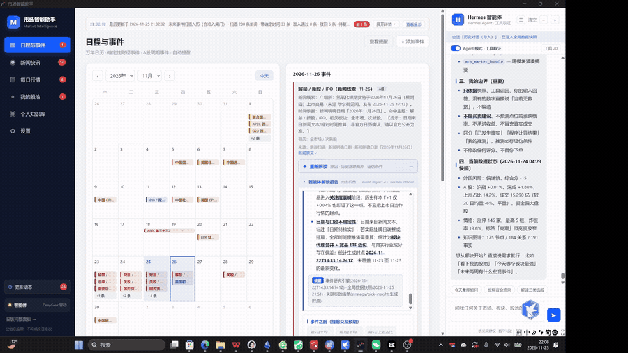
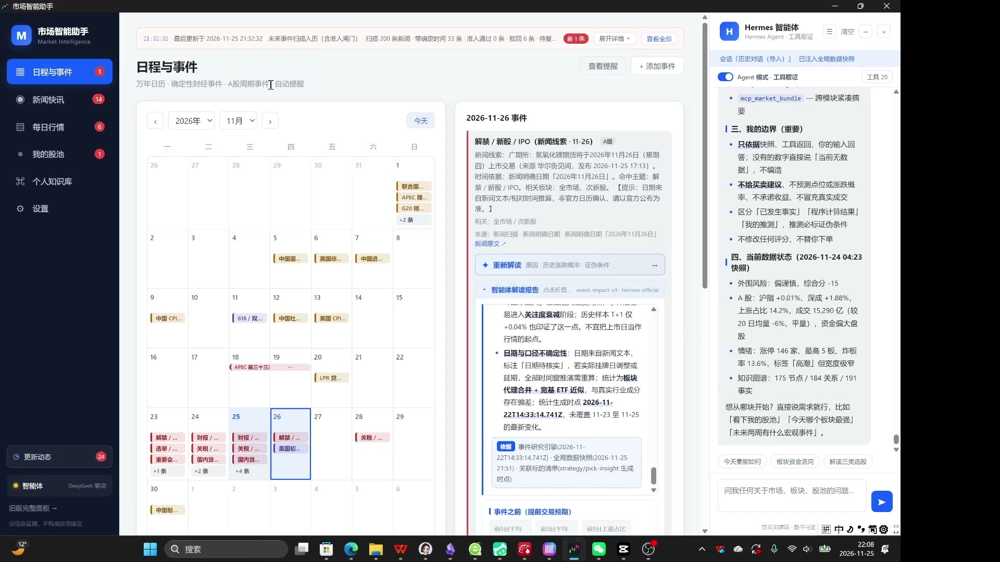
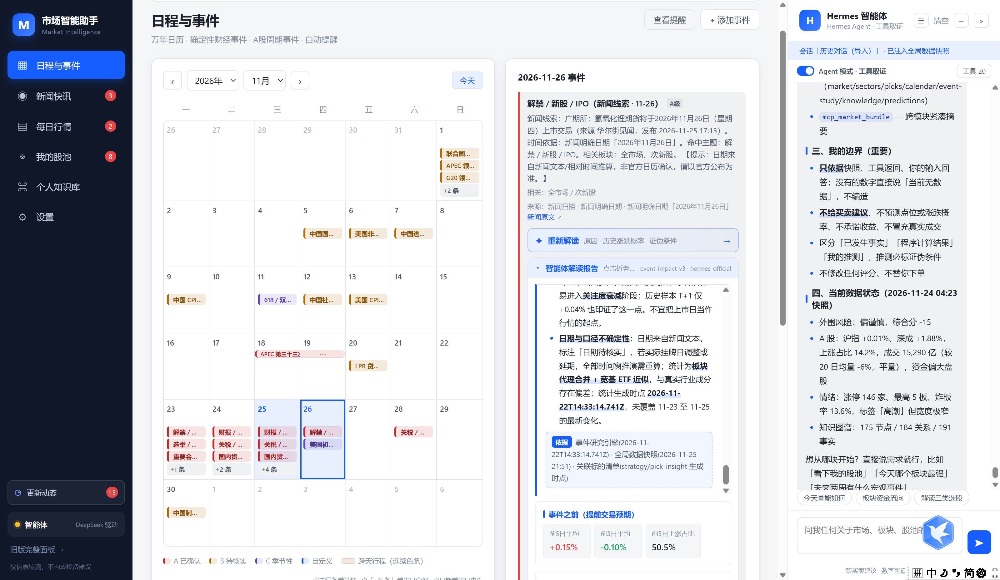
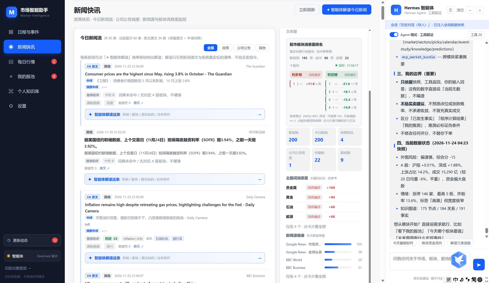
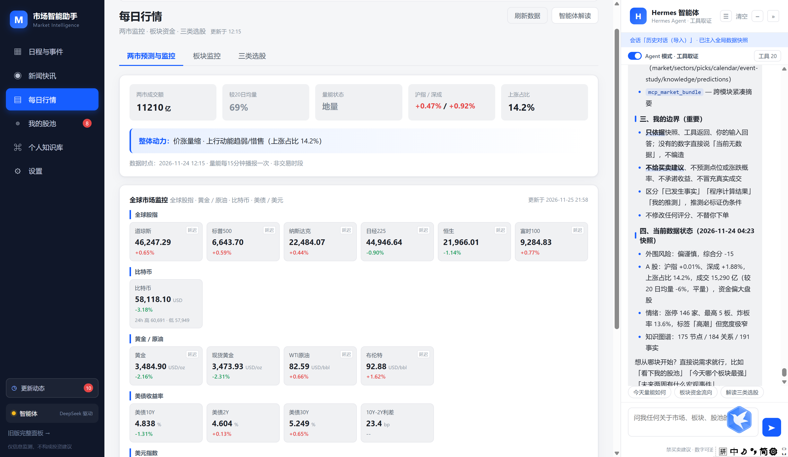
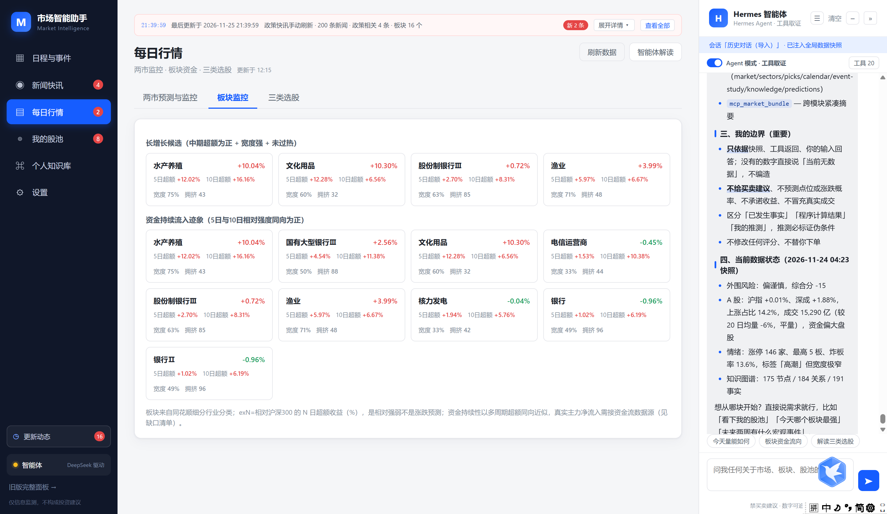
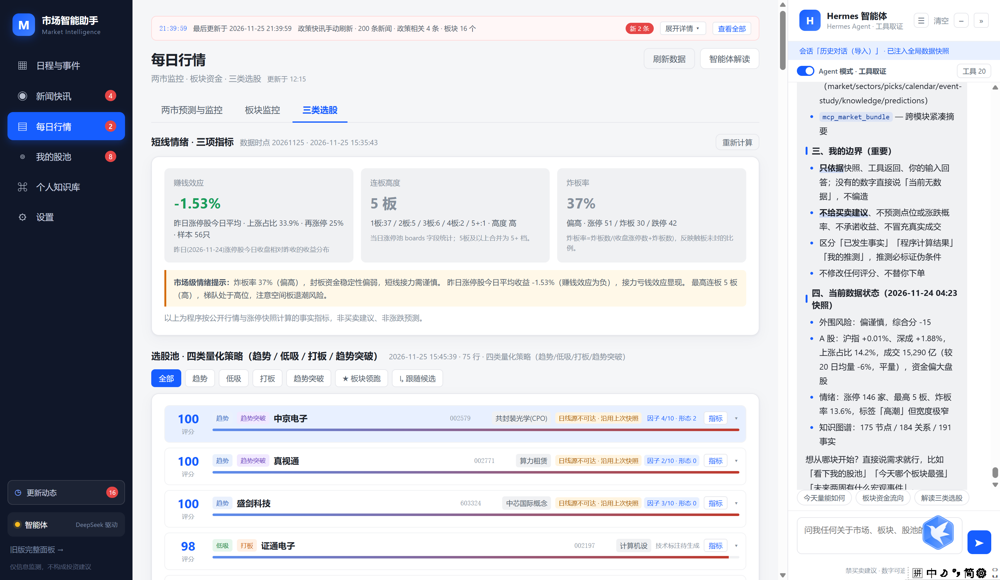
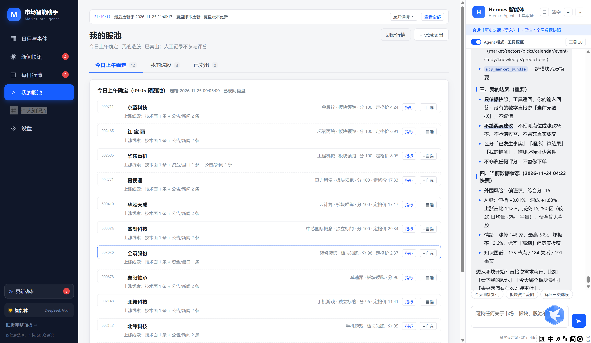
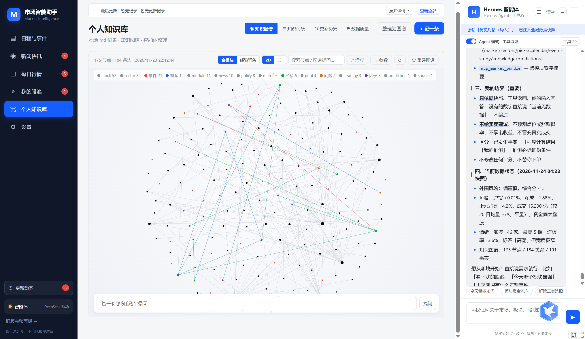

# 全球市场监测与报警系统

[](LICENSE) · 零第三方运行时依赖 · Windows + Node.js 18+ · 仅监听 `127.0.0.1:8777` · 桌面端 / 浏览器双形态

一个在本机常驻运行的实时监测软件：盯 **黄金、原油、美国国债收益率、美元指数** 的价格变化，以及 **全球新闻** 中的高影响事件；触发规则时通过 **声音 + 页内消息 + 桌面通知** 提醒。

在此基础上还提供四块增强能力：

- **新闻自动中文化**：英文标题自动译成中文显示，可一键切回原文，译文落盘缓存。
- **新闻解读**：情感打分、事件主题识别、对各大类资产的消息面方向推理、每日中文综述。
- **当日观察池**：参考 GitHub 上 2025–2026 年开源项目的技术逻辑，用 A 股量价、技术指标、资金流、**个股舆情 + 人气热度 + 外围市场联动**做可解释的多因子评分；新闻或外围行情变化会自动触发重新融合评分。
- **市场状态与事件驱动**：以两市成交额锚（2.5 万亿）叠加历史分位判断「存量博弈 / 增量行情」，用单位资金价格冲击刻画微盘弹性，叠加机构避险温度；公司公告按 18 类规则判定利多/利空及其涉及板块，业绩先判是否超预期，龙头超预期带动同板块并**即时声音 + 消息提醒**。全部作为可解释因子进入观察池评分。

所有数值都是程序从公开接口实时抓取的，界面上每张卡片都标注了**来源 + 数据时点**（统一换算为北京时间）。系统不生成、不编造行情数据；解读与选股是**规则推理**，**不做价格预测**。

---

## 界面一览（实机截图与演示视频）

> 以下 7 张截图与 1 段演示视频全部来自本机实际运行的 v2 界面（2026-11-26），未做修饰。画面中的行情、新闻与个股数据是当时公开接口抓取的**历史快照**，仅用于展示界面与功能，不构成投资建议。

**快速演示**（18 秒节选，GIF 自动播放，无需点击）：



**完整演示视频**：[⬇ 76 秒 1080P 完整版 MP4（约 71 MB）](docs/showcase/demo-walkthrough.mp4) —— 原始视频未压缩、未剪辑，点击下载后用任意播放器观看；也可在文件页点 `View raw`。GitHub 对**提交进仓库**的大 MP4 只提供下载 / raw，不提供内联播放器，所以这里用上面的动图做首屏预览。

[](docs/showcase/demo-walkthrough.mp4)

<table>
  <tr>
    <td width="50%" valign="top">
      
      <br><b>① 日程与事件</b><br>月历网格 + 当日事件详情 + 事件解读；A/B/C 分级、跨天连续色条、美股休市 / 早收角标，右侧为常驻智能体面板。
    </td>
    <td width="50%" valign="top">
      
      <br><b>② 新闻快讯</b><br>中英双语快讯（保留英文原文）、单条「智能体解读这条」、金融 / 政策 / 公司公告筛选，右侧为板块与主题热度、新闻源覆盖概览。
    </td>
  </tr>
  <tr>
    <td width="50%" valign="top">
      
      <br><b>③ 每日行情 · 两市预判与监控</b><br>两市成交额 / 20 日均量 / 涨停占比与量能结论，全球股指、黄金原油、美债收益率；每张卡片标注来源与数据时点。
    </td>
    <td width="50%" valign="top">
      
      <br><b>④ 每日行情 · 板块监控</b><br>长增长赛道（中期超额 + 宽度 + 未过热）、资金持续流入迹象，逐板块列出超额、宽度与拥挤度。
    </td>
  </tr>
  <tr>
    <td width="50%" valign="top">
      
      <br><b>⑤ 每日行情 · 三类选股</b><br>短线情绪三指标（赚钱效应 / 连板高度 / 炸板率）与四类量化策略选股池，逐只给出可追溯的证据链，不给买卖建议。
    </td>
    <td width="50%" valign="top">
      
      <br><b>⑥ 我的股池</b><br>「今日上午确定 / 我的选股 / 已卖出」分栏，逐只列出入选线索、所属板块与评分，人工记录不参与自动评分。
    </td>
  </tr>
  <tr>
    <td width="50%" valign="top">
      
      <br><b>⑦ 个人知识库</b><br>2D 知识图谱（截图为 175 节点 / 184 关系）、按类型着色与筛选，底部支持基于本地知识的自然语言提问。
    </td>
    <td width="50%" valign="top">
      <br><b>素材与口径</b><br>
      • 原始文件：<code>docs/showcase/</code>（7 张 PNG 截图 + 18 秒 GIF + 完整 MP4 + 封面帧）<br>
      • 左侧导航：日程与事件 / 新闻快讯 / 每日行情 / 我的股池 / 个人知识库 / 设置<br>
      • 右侧常驻「Hermes 智能体」面板，AI 产出标注「AI 提案 · 未生效」，不自动改评分、不下单<br>
      • 视频约 71 MB，低于 GitHub 单文件 100 MB 上限（>50 MB 会收到体积提示，不影响下载）<br>
    </td>
  </tr>
</table>

---

## 一、快速开始

1. **推荐**：双击桌面的 **`全球市场监测-启动.bat`**（唯一日常入口，指向同一个项目）。也可双击项目根目录的 `启动监控.bat`，两者启动的是同一个服务、同一个界面，效果完全相同。
2. 程序会启动本地服务（仅监听 `127.0.0.1:8777`，不对外暴露），并自动用 Edge / Chrome 的独立应用窗口打开仪表盘。若没有找到浏览器，会自动用默认浏览器打开；也可以手动访问 `http://127.0.0.1:8777`。
3. **首次打开请点击页面任意处**（或顶部「声音」按钮），浏览器才允许播放声音；再点击「桌面通知」授权系统通知。
4. **默认已配置无人值守**：登录后由计划任务自动拉起服务（隐藏窗口、无黑框），另有看门狗每 30 秒探活、异常自动重启，详见下一节「无人值守与自愈」。手动双击 bat 仍可作为一次性调试入口（会显示黑色控制台，关闭窗口即停止该次进程）。
5. 首次启动后，新闻中文与解读约 10–30 秒自动补齐；观察池需拉取五个榜单、热榜报价、个股资讯与日线，约 30–60 秒后生成，无需手动操作。

> 环境要求：Windows + Node.js 18 及以上（已装过 WorkBuddy 的机器会自带 Node，脚本会自动查找）。无需 `npm install`，零第三方依赖。
>
> 换端口：`set PORT=8888` 后再运行脚本。不想自动打开浏览器：命令行运行 `node server/server.js --no-browser`。

---

## 一·B、无人值守与自愈（2026-11-25 配置）

服务本体仍是零依赖的单进程 `node server/server.js`，监听 `127.0.0.1:8777`。它**不会自己启动、也不会自己活过来**，因此配了两条 Windows 计划任务（均由任务计划服务托管，不依赖任何聊天会话 / 终端窗口）：

| 计划任务 | 触发 | 作用 |
|---|---|---|
| `GlobalMarketMonitor-Watchdog` | 用户登录时 | 常驻运行 `scripts\watchdog.ps1`：每 30 秒请求 `/api/health`，不通则以隐藏窗口拉起 `node server/server.js --no-browser`；连续失败按 30→60→120→300 秒退避 |
| `GlobalMarketMonitor-HealthCheck` | 每 1 分钟 | 跑 `watchdog.ps1 -Once` 单次探活并按需拉起，作为看门狗自身意外退出时的兜底 |

- 脚本全部在 `D:\WorkBuddy\projects\GlobalMarketMonitor\scripts\`（`watchdog.ps1`、`start-watchdog.vbs`、`run-watchdog-once-hidden.vbs`），无第三方依赖、纯 ASCII 避免 PowerShell 5.1 编码问题。
- 两条任务的定义快照在 `scripts\GlobalMarketMonitor-*.xml`（含本机 SID 与绝对路径，已由 `.gitignore` 排除，不入库）。重装 / 迁移时用 `Register-ScheduledTask -TaskName <名称> -Xml (Get-Content <xml> -Raw) -Force` 导入。**坑**：`GlobalMarketMonitor-Watchdog.xml` 的 `LogonTrigger` 必须显式写 `<UserId>LAPTOP-LR6QMSGC\58451</UserId>`；省略时语义变成「任何用户登录」，非管理员会话会报 `0x80070005 拒绝访问`。常驻任务还需 `PT0S`（无执行时限）与 `IgnoreNew`（防重复实例）。
- 日志：`data\watchdog.log`（探活与重启记录，自动保留最近 2000 行）、`data\service-stdout.log` / `data\service-stderr.log`（服务输出，每次重启覆盖）。
- 启动用的是隐藏 `cmd.exe` 而非 `Start-Process`：本机同时存在 `https_proxy` 与 `HTTPS_PROXY` 大小写变体，`Start-Process` 构造 .NET 环境变量字典会抛「已添加项」错误，故绕开。
- 服务启动后自举 15+ 模块并常驻定时器：行情 15 秒、量能风格 5 分钟、板块强度 10 分钟、技术标注 30 分钟；`scheduler` 每 60 秒检查，交易日按点跑 9 个任务（含 **15:40 选股 / 15:45 双池**），状态写 `scheduler-state.json` 防重启重复。

**⚠ 想手动停止服务时**：直接结束 `node.exe` 会被看门狗在 30 秒内重新拉起。正确做法是先停任务，再停进程：

```powershell
Stop-ScheduledTask -TaskName 'GlobalMarketMonitor-Watchdog'
Disable-ScheduledTask -TaskName 'GlobalMarketMonitor-Watchdog'
Disable-ScheduledTask -TaskName 'GlobalMarketMonitor-HealthCheck'
# 然后才结束 8777 端口对应的 node 进程
```

恢复时重新启用并启动即可：

```powershell
Enable-ScheduledTask -TaskName 'GlobalMarketMonitor-Watchdog'
Enable-ScheduledTask -TaskName 'GlobalMarketMonitor-HealthCheck'
Start-ScheduledTask -TaskName 'GlobalMarketMonitor-Watchdog'
```

**边界**：当前触发器是「用户登录时」，因此开机后若未登录（或会话注销）不会运行；如需真正开机即跑，需管理员权限把主体改为 SYSTEM / `AtStartup`（注意 SYSTEM 会话无用户级代理变量，需另行验证外网连通）。另外服务仍依赖东财 / 新浪 / 腾讯 / CNBC 等公开源，断网时只展示缓存快照；交易日 09:00–15:45 之间若电脑关机，当天定时选股快照会缺失（调度器错过 5 分钟不补跑）。

---

## 一·C、桌面端应用（2026-11-25 新增）

除了网页版 bat / 计划任务常驻，现在还有一个**真正的 Windows 桌面应用**：自带 Node 运行时与 Chromium 内核，双击即开，不需要本机装 Node、不需要命令行、不需要浏览器窗口。

**位置与入口**

- 成品目录：`D:\WorkBuddy\projects\GlobalMarketMonitor\dist\GlobalMarketMonitor-win32-x64\`
- 主程序：`GlobalMarketMonitor.exe`（215 MB），整包约 362 MB，绿色免安装、不写注册表、不装服务。
- 已在**桌面**和**开始菜单**创建 `全球市场监测` 快捷方式，图标取自项目 `app-icon.ico`。

**架构与运行模式**

Electron 43 主进程（`desktop/main.js`）负责窗口、托盘与进程管理；现有 `server/server.js` 一行不改，作为子进程用 Electron 自带的 Node 拉起，仍然只监听 `127.0.0.1:8777`。因此桌面版与网页版看到的是同一套真实数据与同一套界面。

启动时会先探活 `/api/health`，自动二选一：

| 场景 | 行为 |
|---|---|
| 8777 上已有健康服务（例如计划任务看门狗先跑起来） | 直接复用，不重复启动；退出桌面应用时**不会**杀掉别人的服务 |
| 8777 空闲 | 自己 fork 一个内置服务；托盘「退出」时一并回收 |

也就是说桌面版与「一·B」的计划任务**不冲突**：谁先占端口谁托管，另一个自动复用。只想用桌面端时，可停用计划任务，改由桌面端 + 托盘常驻承担；两者都留着则桌面端关掉后采集也不中断。

**窗口与托盘**

- 点右上角关闭 = **隐藏到系统托盘**，后台行情采集与定时任务继续跑（首次会弹气泡提示）；托盘「退出」才真正结束。
- 托盘右键：打开主界面 / 在浏览器中打开 / 查看服务托管状态 / 重启后台服务（仅本应用托管时可用）/ 打开数据目录 / 打开日志 / 关于 / 退出。
- 快捷键：`F5` 或 `Ctrl+R` 刷新，`F12` 开发者工具，`Ctrl+Q` 退出。外部链接一律交给系统默认浏览器，不在应用内打开。
- 窗口尺寸与位置记忆在 `%APPDATA%\GlobalMarketMonitor\window-state.json`。

**数据位置**

```
dist\GlobalMarketMonitor-win32-x64\resources\app\data\
  config.json / holdings.json / my-picks.json / calendar\ / daily\  ...
  desktop.log            桌面端日志（启动异常先看这里）
  desktop-server.log     内置服务 stdout/stderr
```

打包时用 `asar=false`，保证服务端大量 `path.join(__dirname,'..','data')` 的路径语义不变、data 目录可写。升级时构建脚本会备份并回填整个 data，持仓、配置、日历与历史快照不丢。

**构建与维护**

```bash
npm install                       # 首次：装 Electron 与打包器（本机缓存已命中，约 30 秒）
npm run build:desktop             # 默认增量更新：只同步源码到 resources/app，data 原样保留
npm run build:desktop -- --full   # 完整重建（会先把旧包移到 dist\.prev-*）
npm run shortcuts                 # 重建桌面 / 开始菜单快捷方式（静默，无弹窗）
npm run shortcuts:remove         # 移除快捷方式
```

成品目录里另附 `创建桌面快捷方式.vbs` / `卸载快捷方式.vbs` / `使用说明.txt`，供不碰命令行的日常使用。

**验收方式**（无界面自检，结果写 `data/desktop-selftest.json`）：

```bash
GlobalMarketMonitor.exe --self-test                 # 探活 → 必要时拉起服务 → 校验首页 200 → 回收
GlobalMarketMonitor.exe --shot=D:\...\window.png    # 加载真实页面后截图，核对渲染
```

**边界**：目前只打包 `win32-x64`；exe 未做代码签名，首次运行可能被 SmartScreen 提示「更多信息 → 仍要运行」；从某些 IDE 内置终端启动时要留意环境变量 `ELECTRON_RUN_AS_NODE=1`（宿主注入会强制 Electron 以纯 Node 模式跑），用桌面快捷方式由资源管理器启动则不受影响。

---

## 一·D、GitHub 仓库与「换一台电脑怎么用」（2026-11-25 新增）

**仓库（公开）**：<https://github.com/fanbingqian/A-share-assistant> · 中文名「**A股助手**」
**免安装包**：该仓库 **Releases** 里的 `GlobalMarketMonitor-win32-x64-v2.0.0.zip`

仓库里放的是**纯净源码 + 构建脚本 + 文档 + 脱敏配置模板**；363 MB 的免安装成品不走 git（单个 exe 225 MB 已超 GitHub 单文件 100 MB 限制），而是作为 Release 附件分发。

### 别的电脑需要装环境吗？—— 不需要

| 依赖 | 是否需要 | 原因 |
|---|---|---|
| Node.js / npm | **不需要** | 桌面端用 `fork(server/server.js)` + `ELECTRON_RUN_AS_NODE=1`，即拿自带的 `electron.exe` 当 Node 运行时 |
| `npm install` / 第三方包 | **不需要** | `server/*.js` 只用 `node:fs`/`node:http`/`node:crypto`/`node:sqlite` 等**内置模块** + 项目内相对模块；打包产物 `resources/app/` 下没有 `node_modules` |
| 浏览器 | **不需要** | Electron 自带 Chromium（`libEGL.dll`、`icudtl.dat`、`locales/` 等随包） |
| Python / .NET / VC++ 运行库 | **不需要** | 成品为自包含原生包；个别精简版系统若提示缺 DLL，才需补装 VC++ 运行库 |

> 注意区分：本页「一、快速开始」里的 `启动监控.bat` 是**网页版**入口，那条路径需要 Node 18+；**桌面端 / Release 包不需要**。

### 从 Release 安装（推荐，零环境）

1. 下载 `GlobalMarketMonitor-win32-x64-v2.0.0.zip`，**解压整个文件夹**到一个有写权限的目录，例如 `D:\A股助手\` 或桌面；**不要**放在 `C:\Program Files`（程序要往自身 `resources\app\data\` 写数据），路径尽量不含中文与空格。
2. 双击 `GlobalMarketMonitor.exe`。首次运行 Windows SmartScreen 可能拦截 → 点「**更多信息 → 仍要运行**」（exe 未做代码签名）。部分安全软件会对「应用起本地服务」弹窗询问，选允许即可（服务只监听 `127.0.0.1`，不对外暴露）。
3. 发行包**已清空 API Key**，首次进入「设置 → 智能体」填入自己的 DeepSeek API Key（或编辑 `resources\app\data\config.json` 的 `agent.apiKey`，也可复制仓库根目录 `config.example.json` 作模板）。不配 Key 时行情、新闻、技术标注、复盘等均可正常使用，仅 AI 解读不可用。
4. 可选：双击包内 `创建桌面快捷方式.vbs` 建立桌面与开始菜单图标。

### 六条限制（换机前必读）

1. **必须拷整个文件夹**，只拷 exe 会缺 `resources/app` 里的服务端与界面。
2. **仅 Windows 10/11 64 位**。macOS / Linux 需要用 `npm run build:desktop` 另行打包对应平台。
3. 本机「一·B」的**计划任务看门狗不会随包迁移**：新电脑关窗口 = 收进托盘、服务继续；托盘里「退出」= 服务一并停止，且**不开机自启**。需要常驻可照「一·B」在新机重新配置，或保持应用最小化到托盘。
4. **程序启动不联网也能打开**，但行情、新闻、机构观点快照更新与 AI 解读都需要联网；断网时只展示缓存快照。
5. 若新电脑 **8777 端口被其它程序占用**，桌面端会按「一·C」的规则直接复用那个服务；可设环境变量 `GMM_PORT=8877` 换端口。
6. 发行包已清除个人持仓、日历、日志与全部缓存快照，**首次运行会重新抓取并生成数据**，观察池约 30–60 秒后补齐。

### 从源码自行构建（开发者）

```bash
git clone https://github.com/fanbingqian/A-share-assistant.git
cd A-share-assistant
cp config.example.json data/config.json   # 生成个人配置，填入自己的 API Key
npm install                               # 仅构建阶段需要：Electron 43 + @electron/packager
npm run build:desktop                     # 产出 dist/GlobalMarketMonitor-win32-x64/
npm run shortcuts                         # 可选：创建桌面与开始菜单快捷方式
```

构建阶段才需要 Node 18+ 与 npm；**构建出来的成品在任何 Windows x64 电脑上都无需环境**。默认增量构建只同步源码到 `resources/app`，不触碰 `data`，升级不丢数据；`--full` 为完整重建。

### 隐私与脱敏说明

- 仓库**不含** `data/` 运行数据（API Key、持仓、自选、日历、日志、行情与新闻缓存均被 `.gitignore` 排除）；唯一例外是 `data/macro-expectations.json`——它是程序内置的机构预测静态快照，属公开信息，缺失会导致宏观增强解读不可用。
- `config.example.json` 为脱敏模板，`agent.apiKey` 为空；`hermes-bridge/` 下的调试文本已把明文密钥替换为 `sk-REDACTED`。
- **Release 发行包同样经过脱敏**：清空 API Key、个人持仓 / 日历 / 日志与缓存，仅保留可启动的最小 `data` 结构（`server/config.js` 的 `loadConfig()` 在配置缺失时会回落到 `DEFAULT_CONFIG`）。
- 请勿把自己的 `data/config.json` 提交进仓库或打进发行包。

---

## 一·E、设置页「智能体连通性检测」怎么看（2026-11-25）

「设置 → 智能体大模型 → 发起连通性检测」会向两条后端各发一次真实最小请求（约 16 token）：

| 显示项 | 含义 |
|---|---|
| 官方 Hermes `✓ 在线` / `✗ fetch failed` | 本机 `127.0.0.1:8765` 上的 **官方 Hermes Agent 通道**。它走 WSL2 里的 Hermes CLI，带持久记忆、技能、MCP 工具取证，单次约 20–60 秒 |
| DeepSeek 兜底 `✓ 在线` | Node 直连 DeepSeek API，快（1–2 秒），但**没有**记忆 / 技能 / 工具取证，只是纯文本生成 |
| 实际可用路径 | `hermes-official`（优先）或 `deepseek-fallback`（降级） |
| 总体「连通正常」 | 只要有一条通就正常——**不代表两条都通** |

**`fetch failed` 的确切含义**：Node 的 `fetch()` 连 `127.0.0.1:8765` 时被拒绝（ECONNREFUSED），即那一刻**没有任何进程监听 8765**。最常见原因是 WSL2 Ubuntu 被 Windows 回收成 `Stopped`，WSL 内 `hermes-bridge.service` 随之消失；此时系统按 `backend=auto` 自动降级到 DeepSeek，**所有 AI 解读功能照常可用**，只是少了 Hermes 的记忆与工具能力。不是模型故障，也不是 Key 失效（Key 失效会显示 `HTTP 401` 而不是 `fetch failed`）。

**本机已配置的自愈**（换电脑后不适用，见下方）：

- `hermes-bridge/hermes-bridge-win.js`：Windows 侧监听 `127.0.0.1:8765`，收到请求后用 `wsl.exe` 调官方 Hermes CLI。**WSL 被回收也没关系**——每次调用会按需自动唤醒发行版。
- `scripts/watchdog.ps1`：同时探活 8777 与 8765；常驻循环每 30 秒、`GlobalMarketMonitor-HealthCheck` 每 1 分钟各兜底一次，掉线自动拉起。
- 启动文件夹的 `开机自启-Hermes桥接Windows.vbs`：登录时静默唤醒 WSL 并拉起 Windows 侧桥接（纯 ASCII，避免中文编码问题；node 路径带双 fallback）。

手动验证 / 修复：

```powershell
wsl -l -v                                                    # 看 Ubuntu 是否 Stopped
curl http://127.0.0.1:8765/health                            # 应返回 200 + hermes-bridge-win
powershell -ExecutionPolicy Bypass -File scripts/watchdog.ps1 -Once   # 一次性自愈
```

**换一台电脑时**：发行包不含 WSL / Hermes，也不含上述计划任务，因此检测会稳定显示「官方 Hermes ✗ / DeepSeek 兜底 ✓ / 实际路径 deepseek-fallback」——这是**预期行为**，不是故障。想在新电脑上启用官方 Hermes，需自行安装 WSL2 + Hermes Agent 并部署桥接。

---

## 一·F、日程准入复核台（2026-11-25 新增）

**背景**：自动扫描曾把一条「已发生的转述报道」误写入日程——原文「这项决定于**上周日**下午敲定」被当成未来相对时间推算出 11-29，裸词「公布」被当成预告语义，公司名「英伟达」被误命中为「美股科技巨头财报」事件类别，且旧链路全程没有准入判定与真伪校验，`upsertEvent()` 直接写库（`verified:false` 当时只表示「日期未确认」）。

**三道关，默认拒绝（fail-closed）**：

1. **确定性硬闸门**（`server/calendar-gate.js`）：R1–R7 判定「是否未来预告事件 / 时间是否绑定到事件本身 / 是否回顾语境 / 是否匿名信源 / 是否公司名误命中」，失败一律驳回，不靠 AI 猜。同步修掉 `future-events.js` 的相对周几时态误判、收紧 `FORECAST_RE`、公司名须搭配财报语义才算财报事件。
2. **智能体结构化审查**：仅对闸门通过的候选输出严格 JSON 建议（准入建议、真伪风险、信源等级、核实途径），**不改事实、不预判行情、无权把驳回升级为放行**；结论带缓存，超时或失败按「无 AI 结论」降级为待复核。
3. **合并决策 + 人工复核**：程序**不做事实裁定**，只做 official / 权威 / 转述 / 匿名 / 未知五级信源分级；驳回落黑名单防回写，仅 `admit` 才写入日历，事件附带 `gate` 元数据（准入结论 · 信源等级 · 真伪状态 · 智能体意见）。

前端「日程与事件 → 准入复核台」可查看复核队列、核验证据卡与黑名单，支持人工放行（**立即写入日历**，不等下次扫描）与驳回、含智能体实时重扫。接口集中在 `/api/v2/calendar/gate/*`（status / review / evidence / blacklist / decide / rescan 等）。

**验证脚本**（零副作用、自动清理测试数据）：

```bash
node scripts/verify-calendar-gate.js   # 6/6：回顾语境驳回、官方预告保留、AI 无权越权放行
node scripts/verify-gate-decide.js     # 3/3：人工放行即写日历、驳回登记黑名单
```

> 程序只标注来源分级与口径差异，**官方公告始终是最终口径**；`verified` 仅表示日期是否经官方日历确认，不代表消息真伪已被裁定。手动扫描需等智能体审查约 1 分钟，前端已加 loading 与防重复点击。

---

## 一·G、美股休市日历（2026-11-26 新增）

**数据源**：NYSE 官网 [Holidays & Trading Hours](https://www.nyse.com/markets/hours-calendars)（附 [Trading Days PDF](https://www.nyse.com/publicdocs/Trading_Days.pdf)），页面公布 **2026 / 2027 / 2028** 三年，本机核实于 2026-11-26。NYSE 与 Nasdaq 采用同一股票市场休市日历。

| 年份 | 全天休市 | 提前收盘（13:00 ET，期权 13:15） | 分级 |
|---|---|---|---|
| 2026 | 10 天 | 11-27、12-24 | A · 官方已公布 |
| 2027 | 10 天 | 11-26 | A · 官方已公布 |
| 2028 | 9 天（1/1 逢周六，官网脚注明确不补休） | 07-03、11-24 | A · 官方已公布 |
| 2029+ | 10 天（按 NYSE 假日规则推算） | 不生成（官网未公布，不臆造） | B · 待官方确认 |

**口径与边界**：

- 只写「全天休市」与**官网脚注明确列出**的提前收盘；第三方日历另列、官网未确认的提前收盘日一律不收录。2029 起仅推算全天休市，`grade=B / confirmed=false / source=nyse-rule-projection`，绝不把推算冒充已公布。
- 仅指美国**股票**市场（NYSE / Nasdaq / NYSE American 等）。**A 股、港股、中国期货照常交易**；美股股指期货与美国债券市场（SIFMA 日历）另有安排，事件卡详情里逐条写明，避免误读为「A 股也休市」。
- 属制度性确定性事件库（与 A 股披露截止日、FOMC 官方会议日历同级），由 `server/us-market-holidays.js` 生成、`calendar.js::expandRules()` 合并，**不写入 `data/calendar/events.jsonl`**、不经过新闻准入闸门、也不被每小时新闻扫描重复追加；因此不适用一·F 的「新闻线索证真伪」流程。
- 休市 / 提前收盘是日历背景信息，**不进自动提醒弹框**（不新增每日弹窗噪音），但显示在日历网格、当日事件与「未来 30 天」。前端用中性灰蓝虚线样式与 A/B/C 等级色区分，格子右上角有 `US 休` / `US 早收` 角标，并在图例注明「NYSE 官方」。
- 交易所临时休市（如全国哀悼日）由临时公告决定，系统不预判；官网更新年度表后，人工维护 `OFFICIAL_CLOSED` / `OFFICIAL_EARLY_CLOSE` 即可，不改动任何行情或评分逻辑。

**验证**：

```bash
node scripts/verify-us-market-holidays.js   # 23/23：官方日期逐条核对、分级纪律、提醒去重、前端接入
```

> 本表为交易所官方日历事实，不构成投资建议，也不对任何市场走势作判断。

---

## 一·H、美联储 FOMC 议息会议官方日历（2026-11-27 新增）

**数据源**：美联储官网 [FOMC Meeting calendars, statements, and minutes](https://www.federalreserve.gov/monetarypolicy/fomccalendars.htm)，本机核实于 2026-11-27。

**下一次会议**：**2026-12-08 ~ 12-09（周二–周三）**，含经济预测摘要 SEP 与点阵图，`grade=A / confirmed=true / source=fed-official`。按长期惯例，决议在第二天美东 14:00 发布（北京时间 **12-10 03:00**，冬令时 EST），主席发布会 14:30（北京时间 03:30）；会议纪要在决议三周后发布，官网尚未列出 12 月这次的具体日期，系统留空不臆造。

| 年份 | 会议 | 分级 |
|---|---|---|
| 2026 | 1/27–28、3/17–18\*、4/28–29、6/16–17\*、7/28–29、9/15–16\*、10/27–28、**12/8–9\*** | A · 官网已公布 |
| 2027 | 1/26–27、3/16–17、4/27–28、6/8–9、7/27–28、9/14–15、10/26–27（策略会议）、11/16–17 | B · 官网 Future Year 暂定 |
| 2028 | 1/25–26（官网脚注） | B · 暂定 |
| 2029+ | 官网未公布，不生成 | — |

\* = 附经济预测摘要（SEP / 点阵图）。2026 年前 7 次会议纪要日期逐条照录官网。2027 年起官网明确注明「每次会议日期在前一次会议确认前均为暂定」，故一律标 `B / confirmed=false / source=fed-tentative`，不冒充已公布；2027 年官网未列 12 月例会、改列 11 月，照录不自行补一个 12 月。

**会议进程**（写在每条事件详情里，只陈述流程事实）：两日会议 → 第一天闭门讨论经济与金融形势 → 第二天美东 14:00 发布政策声明、联邦基金利率决定与实施说明（含 SEP 的会议同时发布点阵图及 GDP / 通胀 / 失业率预测）→ 14:30 主席新闻发布会 → 三周后发布会议纪要。**14:00 / 14:30 是 FOMC 长期惯例，官网日历页只列日期不列时刻**；程序按美东夏令时 / 冬令时换算北京时间并标注口径，不预判利率结果、不给涨跌方向、不构成投资建议。

**修了什么**：原 `calendar.js` 的 `fomc` 规则是 `months:[1,3,5,6,7,9,10,12]` + `dayRule:()=>null` —— 既把官网的 **4 月会议误写成 5 月**，又因为无具体日期被展开成「当月 1 日的月事件」（12 月视图里挂在 12/1，`allMonth=true`、B 级、无日期）。现该规则 `months:[]` 停用，改由 `server/fomc-calendar.js` 逐条生成两日会议，前端按跨天连续色条显示在 **12/8 与 12/9**，事件卡带「美联储官网」来源标签。**你看到的 12 月 2 号是「EIA 原油库存周报」（C 级、每周三规律推算），不是议息会议。**

**准确性检查机制**（回答「这类事件有没有被核对」）：

| 事件来源 | 是否核对准确性 | 机制 |
|---|---|---|
| 新闻扫描入历（`news-scan`） | 有 | 一·F 准入复核台：①能否入历 ②信源分级 ③智能体证真伪，未通过不写入 |
| 周期规则推算（`calendar-rule`） | 仅标注、不核事实 | 闸门标 `rule-generated / not-a-news-claim`，明确「非新闻线索、无需真伪核验」，靠 `grade=B/C` + `verified=false` 提示待核实 |
| 制度性官方常量（美股休市 / **FOMC**） | 人工按官网逐条核对 | 本模块照录官网、附 URL 与核实日期，配验收脚本做断言；**不经过智能体审查**，也不自动联网比对，官网更新后需人工维护常量 |

> 换句话说：**自动的「证真伪」只针对新闻线索**。FOMC 这类官方日历过去既没被闸门审查、也没有官方日期，属于设计缺口；本次补成官方常量库 + 验收脚本，但仍是「人工核对 + 程序验证」，不是实时联网校验。若希望每年自动提醒维护，可再加一个官网日历变更检测。

**验证**：

```bash
node scripts/verify-fomc-calendar.js   # 26/26：官方日期 / SEP / 纪要 / 北京时间 / 分级纪律 / 日历接入 / 提醒
```

---

## 二、界面能做什么

| 区域 | 内容 |
|---|---|
| 顶部状态栏 | 实时连接状态、行情/新闻最后更新时间、声音开关、桌面通知开关、立即刷新、告警设置 |
| 结论条 | 当前监测状态（正常 / 关注 / 警戒）、24 小时告警数、最新一条告警、数据链路健康度 |
| 核心监测 | COMEX 黄金、WTI 原油、美债 10Y 收益率、美元指数 —— 大数字、涨跌幅、迷你走势、来源与时点 |
| 扩展指标 | 伦敦金现、布伦特原油、美债 2Y / 30Y、10Y-2Y 期限利差 |
| 走势监测 | 8 个标的的曲线切换、近 1 小时 / 近 4 小时 / 全部区间，标注历史线来源与本地采样来源 |
| 告警中心 | 分级（提示 / 警告 / 严重）、筛选、确认、清空、链路自检；免打扰时段仍会记录但静音 |
| 全球新闻 | **默认中文显示**（「译」标记），右上角可切「原文」；按「市场相关 / 命中关键词 / 原生中文 / 译文」筛选；每条附情绪标签、事件主题、影响倾向、相关度 |
| 新闻解读 | 4 段中文综述 + 情绪分布 / 风险温度 + 5 大类资产方向倾向 + 主导主题 + 重点新闻 Top 6 |
| **A 股量能与市值风格** | 两市成交额与 20 日均量对比、量能状态、量价配合、全市场涨跌家数宽度；微盘 / 小盘 / 中盘 / 大盘四层的成交占比偏移、横截面超额、层内宽度、拥挤度与风格分条；主导风格结论 + 置信度 + 方法学折叠 |
| **涨停结构与市场情绪** | 4 张情绪卡（情绪周期与系数 / 涨停与跌停 / 炸板率 / 最高连板与晋级率）、20 条连板梯队（首封时间、封单占流通市值、封单额、开板次数、换手）、炸板池（区分「尾盘回封」与「未回封」）、冰点/退潮提示、方法学折叠、一键重采 |
| **市场状态与事件驱动** | 4 张宏观卡（量能分档 / 历史分位 / 弹性口径 / 避险温度）、4 张市值层单位资金冲击卡、事件利多与受损板块、重点关注事件列表（可按「全部 / 重点关注 / 利多 / 利空 / 业绩超预期」筛选）、龙头业绩的板块溢出、中文结论与方法学折叠、一键刷新 |
| 当日观察池 | 18 只 A 股的评分、信号、置信度、技术/资金/舆情分组得分、**人气热度与外围联动修正**、**市值层与风格修正**、**板型（一字 / T 字 / 回封 / 换手 / 炸板）**、**事件 / 宏观修正**、核心依据；点击任意行展开完整理由、风险项、双榜名次概念标签、舆情命中新闻、量能风格归层依据、**涨停结构拆解与 K 线形态标签**、事件与宏观因子拆解、**权重结构与估值（PE/PB、价值陷阱）**及 12 项技术指标；「技术逻辑」可展开方法论与 GitHub 参考项目 |
| **评分有效性自检** | 快照与标注进度、T+1/3/5/10 的前瞻 Rank IC 卡（ICIR / 正 IC 占比 / t 值 / 分档价差）、12 个因子组的独立预测力条形图、IC 时序折线、可执行建议、经验库列表与方法学折叠、一键补算 |
| **评估数据库与经验库** | 每个交易日 09:00 / 22:00 两档定格名单（每只含**量化指标摘要**与**一句话看多理由**，冻结后不可修改）、**实时观察池**（盘中随评分滚动更新，含新进 / 移出提示与进入时间）、复盘统计卡（命中率 / 平均次日 / 平均超额 / 盈亏比）、待审经验（逐条「采纳并回流 / 驳回」）、已生效回流规则、手动定格 / 立即复盘 / 刷新实时池 |
| **持仓监控** | 用户录入持仓（代码 / 成本 / 股数 / 备注），每 30 秒刷新实时盈亏；与观察池评分联动（在池显示评分与信号，不在池明确标注「无评分意见」）；ATR×2 止损参考；七条确定性建议规则（跌破止损 / 跌停流动性 / 涨停封单 / 大跌查利空 / 浮盈移动止盈 / 浮亏复核逻辑 / 系统看多或转弱）；跌停与破止损自动推送告警（同股同日去重）。不预测涨跌 |
| **周期事件日历** | 未来 45 天临近事件（天数倒计时、类型、影响板块、日期口径标注「规律推算 / 人工录入」）、历史事件形态统计（前 / 中 / 后三段平均超额、出货率）、高置信提前告知（同类 ≥5 次且「前涨后跌」占比 ≥50% 才提示）、方法学折叠、一键重建 |
| **预期研究与多因素叠加** | 板块相对强弱榜（496 个板块、5/10/60 日相对沪深300 超额、趋势主线/加速/刚转强/退潮分档、拥挤度双口径）；市值重估事件（重组/并购/回购）的**条件齐备清单**（重组情况 4 项 + 外部环境 5 项，逐条标满足/不满足/无数据、附公告原文链接、一票否决）；板块阶段研究（事件锚定三段 CAR + 板块自身价格周期 5 阶段、280 根日 K 不重叠窗口）；多因素叠加指纹（10 个独立维度、共振/分歧/承压形态）——**叠加不改分，形态写入经验库定格由复盘统计裁决** |
| **资金主体与避险识别** | 避险形态结论（L1 轮动 / L2 风格 / L3 离场 / L4 离境）+ **明确回答「钱去了其他板块还是出了股市」**+ 逐项证据链；主体画像（机构专用 / 沪深股通 / 拉萨系散户通道 / 高频活跃席位，含上榜次数、净买、次日均值、胜率、市值层偏好）；四层市值资金倾向（20 日与 5 日、机构与席位拆分）；两融余额趋势与分位；大宗交易与筹码集中度 |
| 数据源状态 | 每个源的连通性与响应耗时，主源异常自动降级 |

**颜色约定**：遵循 A 股习惯，**红涨绿跌**。收益率上行显示为红色、下行为绿色，仅表示数值方向，不代表利好或利空。消息面「偏多」用红色、「偏空」用绿色，同样只表示规则推理的方向，不是涨跌预测。

---

## 三、数据来源（2026-11-13 / 11-15 / 11-25 于本机实测连通）

| 类别 | 来源 | 说明 |
|---|---|---|
| 主行情 | CNBC Quote API（交易所 / Tradeweb） | 一次请求取 US10Y、US2Y、US30Y、@GC.1、@CL.1、@LCO.1、.DXY；接口自带 `realTime` 标记与交易所时间戳 |
| 实时补充 | 新浪财经外盘行情 | `hf_GC` / `hf_CL` / `fx_sxauusd`，补充伦敦金现与商品实时参考价（GBK 编码已处理） |
| 备用源 | 东方财富行情中心 | 仅在主源失败时按需启用，避免并发限流 |
| 历史线 | Yahoo Finance 5 分钟 K 线 | GC=F / CL=F / BZ=F / ^TNX / ^TYX / DX-Y.NYB，启动时加载用于首屏走势 |
| 新闻（20 个源，2026-11-25 补齐金融垂直源） | Google News RSS（市场关键词 / 全球头条 / **中文财经** / **中文市场** / **金融市场**）、BBC World / Business、Al Jazeera、**CNBC（Top News / Finance / Economy / Earnings / Investing）**、**MarketWatch**、**Investing.com**、**SEC 新闻稿**、中新网财经、华尔街见闻 A股 / 全球快讯、**东方财富快讯** | 去重后用 `finance-relevance.js` 双语词表打「金融相关性 + 5 类主题标签」；池子按**金融优先保底**（金融 160 / 单源上限 40 / 总量 200）保留，不再被综合新闻按时间挤掉；The Guardian 因服务端 fetch 间歇 403 且非金融源，已替换为 CNBC Top News |
| 中文翻译 | Google `translate_a/single` gtx 公共端点 | 换行批量翻译，逐条失败降级重试；**非官方付费 API**，随时可能变更或限流，失败时保留原文并标注 |
| A 股榜单 / 资金 | 东方财富 `push2` clist | 涨幅榜、成交额榜、主力净流入榜；含现价、涨跌幅、换手、量比、市值、主力净流入、所属行业 |
| A 股日线 | 东方财富 `push2his` kline | 60+ 根前复权日线（开高低收量额、涨跌幅、换手），用于全部技术指标 |
| 人气热度 | 东财人气榜 `emappdata/stockrank`、同花顺热榜 `dq.10jqka` | 各前 100 名：名次、排名变动、热度值、概念与人气标签、异动线索；休市为最近交易时段快照 |
| 热榜报价 | 东方财富 `push2/ulist.np` | 按 secid 批量补齐热榜成分股的成交额、资金流、行业等评分字段（每批 50 只） |
| 个股资讯 | 东方财富 `np-listapi/getListInfo` | 每只标的 8 条中文个股相关资讯标题 + 时间 + 原文链接；个股舆情的主要来源 |
| 规模指数日线 / 快照 | 东方财富 `push2his/kline`（`2.932000` 中证2000、`1.000852` 中证1000、`1.000905` 中证500、`1.000300` 沪深300）+ `push2/ulist.np` | 约 70 根日线的成交额、收盘、涨跌幅、换手率，作为四个市值层的可交易代理；另取 `1.000001` 上证 + `0.399001` 深证成指算两市总量能 |
| 全市场横截面宽度 | 东方财富 `push2/clist`，`pz=100` 分页 × 56 页 | 约 5500 只个股的流通市值 `f21`、涨跌幅、成交额、主力净流入；按流通市值分档聚合层内涨跌家数，独立 20/180 分钟缓存，限流时降级用上次快照 |
| 公司公告 / 重大事项 | 东方财富 `np-anotice-stock/api/security/ann` | 最近约 300 条 A 股公告的标题、栏目、代码、时间与原文链接；按 18 类规则识别重组 / 收购 / 回购 / 减持 / 增持 / 立案 / 解禁等，**标题优先于栏目**，流程性文件与反向词过滤 |
| 业绩预告 / 业绩快报 | 东方财富 `datacenter-web/api/data/v1/get`（`RPT_PUBLIC_OP_NEWPREDICT` / `RPT_FCI_PERFORMANCEE`） | 预告类型、净利同比中值与变动原因；快报的净利同比 + 营收同比，共同用于业绩超预期打分 |
| 个股行业 / 流通市值 | 东方财富 `push2/qt/stock/get` | 业绩事件个股的所属行业与流通市值，用于龙头判定与同行业板块联动；限流失败时用报表 `PUBLISHNAME` 行业名降级 |
| 个股估值 | 东方财富 `push2/clist` 的 `f9`（动态市盈率）/ `f23`（市净率） | 与榜单同一次请求返回，用于价值陷阱过滤；负 PE（亏损）不算低估值 |
| 涨停池 | 东方财富 `push2ex.eastmoney.com/getTopicZTPool` | 每只涨停股的首/末封板时间、封单资金、连板数、盘中开板次数、几天几板、行业、换手；`p` 单位为厘（÷1000），`fund` 与 `ltsz` 之比为封单占流通市值 |
| 炸板池 | `getTopicZBPool` | 盘中触及涨停但收盘未封住的标的，含涨停价 `ztp`、距涨停幅度、开板次数、振幅；用于区分「尾盘回封」与「炸板未回封」 |
| 跌停池 | `getTopicDTPool` | 仅稳定返回计数 `tc`（明细常为空），用于情绪周期的冰点判定与跌停/涨停比 |
| 交易日历 | 上证指数 `1.000001` 日线 | 480 根日线导出交易日序列，缓存 6 小时（`data/trade-calendar.json`），用于判定前瞻收益的到期日；失败时降级为工作日序列 |
| 前瞻收益（IC 自检） | 东方财富 `push2his` 日线（前复权） | 到期快照涉及的标的按批拉取日线，计算 T+1/3/5/10 个交易日收益；单轮最多 60 只、4 只一批、失败跳过 |
| 龙虎榜席位明细 | 东财 `RPT_BILLBOARD_DAILYDETAILSBUY` | 每「股票 × 席位」的买卖额与净额；交易所对严重异常波动股票披露的投资者结构统计（自然人/中小投资者等）按白名单排除——金额为期间累计值，混入会严重扭曲统计 |
| 龙虎榜个股汇总 | 东财 `RPT_DAILYBILLBOARD_DETAILSNEW` | 个股流通市值（→ 市值层）、上榜原因、D1/D2/D5/D10 次日涨幅（→ 席位胜率） |
| 融资融券个股 | 东财 `RPTA_WEB_RZRQ_GGMX` | 融资余额 / 融券余额 / 融资净买入；无市场级汇总报表，历史按月抽样、当前按日聚合 |
| 大宗交易 | 东财 `RPT_DATA_BLOCKTRADE` | 折溢价率、金额、买卖方营业部，判断机构间转让的意图 |
| 股东户数 | 东财 `RPT_HOLDERNUMLATEST` | 最新披露期的户数环比，衡量筹码集中 / 扩散 |
| 行业板块列表 | 东财 `push2`（`m:90+t:2`，翻页取全约 496 个） | 一/二/三级行业混在同一列表，按名称 + 别名表解析；板块日线用 `push2his` `secid=90.BKxxxx` |
| 防御与避险标的 | 十年国债 ETF（`1.511260`）、COMEX 黄金主连（`101.GC00Y`）、USDCNH（`133.USDCNH`） | 股债跷跷板、全球避险共振、汇率压力三项证据的行情来源 |

**口径说明**
- CNBC 商品期货报价通常标记为「延迟」（界面有橙色标签），美债收益率与美元指数标记为「实时」；延迟品种会额外显示新浪实时参考价，两者合约不同、数值可能略有差异。
- 10Y-2Y 期限利差由 CNBC 的 US10Y 与 US2Y 相减计算，单位 bp（1bp = 0.01 个百分点）。
- Yahoo 历史线与实时采样点的合约/更新节奏不同，图上可能有细微台阶；图注已标明两类点的数量与来源。休市期间报价恒定，系统只推进末点时间、不堆积常数采样点，避免把历史线挤出窗口。
- **A 股为 T+1、有涨跌停限制**。周末、节假日与盘前显示的是**最近交易日收盘数据**，界面顶部有醒目提示，指标不构成次日开盘依据。

---

## 四、新闻中文化与解读

### 4.1 自动中文化

- 英文标题（及前 N 条摘要）批量送翻译端点，译文与按内容哈希的缓存写入 `data/translations.json`，重启后不重复请求。
- 中文原生新闻保持原文，标「中文」；机器译文标「译」；翻译不可用时保留原文并标「原文」，绝不静默伪装成人工翻译。
- 新闻每 60 秒轮询时**沿用已有译文与分析字段**，不会出现中文时有时无；出现未译的新条目会提前触发补译。
- 右上角「原文 / 中文」按钮可随时切换；中文模式下仍以小字保留原标题，便于核对。

### 4.2 解读引擎（`server/analysis.js`）

1. **市场相关性过滤**：RSS 全球头条混杂体育、娱乐、地方政治。用金融词组精确匹配 + 噪音词降权，只让相关新闻进入统计与结论（实测过滤掉约 2/3 无关条目）。刻意不用裸词 `gold` / `oil`，避免「金牌」「橄榄油」误判。
2. **情感打分**：中英双语金融情感词典（约 130 词，含 valence 强度），带否定词与程度副词修正，用 VADER 式 `sum / √(sum²+15)` 归一化到 -100 ~ +100。
3. **事件主题**：12 类主题（地缘冲突、金融避险、货币宽松、加息鹰派、通胀、衰退、减产、需求疲弱、美债供给、关税、科技财报、中国政策），**只依据标题判定**（实测用摘要会把「航班混乱」误判为地缘冲突）。
4. **资产映射**：每个主题带对黄金 / 原油 / 美债10Y / 美元指数 / 股票的方向（-2 ~ +2）与推理逻辑，按新闻重要度加权融合。行业倾向按「行业→受益资产」映射，避免「地缘冲突利多黄金、却给贵金属股票打负分」这类矛盾。
5. **输出**：中文综述、情绪分布、风险温度、资产方向条、主导主题、重点新闻、每条新闻的情绪/主题/影响倾向。

> 方向值表示「消息面通常的传导方向」，**不是价格因果判断，也不是预测**。

---

## 五、当日观察池：技术逻辑与出处

### 5.1 GitHub 开源项目调研与选型（2026-11-15 核对 README）

针对「舆情与股票热度」这一项，重新检索了 2025–2026 年仍在维护的项目，逐个核对 README 后确定取舍：

| 项目 | 关键技术逻辑 | 本系统的取舍 |
|---|---|---|
| [ramhee98/StockSentimentAlpha](https://github.com/ramhee98/StockSentimentAlpha)（MIT，2025-10） | **每标的按日聚合 Sentiment Index**（VADER + FinBERT，输出 label / confidence / compound / pos-neg-neu）；信号权重 **情绪 30% / RSI 25% / MACD 25% / 价格趋势 20%**，阈值 ±0.4 → buy/hold/sell | **采用**「情绪独立成组 + per-ticker 指数 + 置信度」结构，权重按 A 股口径重设；**不采用** buy/sell 信号与 FinBERT（需 transformers/PyTorch/模型权重/GPU，与零依赖 Node 冲突） |
| [sansan0/TrendRadar](https://github.com/sansan0/TrendRadar)（63.6K★，2026 活跃） | 多平台热榜聚合，统计**排名变化 / 出现频次 / 跨平台排名差异**，自定义权重重排；约 30 分钟抓取；README **未公开**权重公式（仅提示 config.yaml 可调三个比例） | **采用**多源交叉 + 排名变化 + 名次归一化的思路；公式由本模块自行定义并在下文公开；**不采用**其 newsnow 依赖与 GitHub Actions 调度 |
| [Open-Dev-Society/OpenStock](https://github.com/Open-Dev-Society/OpenStock)（~20K★） | 每只股票的**跨源情绪卡**（Reddit / X / 财经新闻 / Polymarket），让分歧度可见 | **采用**双源交叉验证与单源/双源置信度表达；**不采用** Adanos / Finnhub / Reddit API（需 key；本机实测雪球 400、股吧 302 跳转） |
| Ayushs6/StockWatch、AjayParthibha/Market-Sentiment-Analyzer、[katsav21/NVDA_Sentiment_Analysis](https://github.com/katsav21/NVDA_Sentiment_Analysis) | Reddit + 新闻 + FinBERT；后者公开实测 NVDA 社媒情绪与股价**相关系数仅 -0.112** | **不采用**：社媒源本机不可达且需 OAuth；该弱相关结果支持「情绪只作横截面相对因子、不用于价格预测」 |
| 666ghj/BettaFish（微舆，42.7K★）、jundizhou/easy-stock | 多智能体舆情 / A 股大 V 观点聚合，需 LLM 与多源爬虫 | **采用**「舆情与行情并列输入」理念；**不采用**重型多智能体实现 |
| [SiD-array/StockView](https://github.com/SiD-array/StockView)（2026-06）、ai-stock-watcher（NUS-ISS 2025）、[Jay7751/QuantFusionAI](https://github.com/Jay7751/QuantFusionAI)（2026-01）、autowealth-ai、[Creeper998/daily_stock_analysis](https://github.com/Creeper998/daily_stock_analysis)（2026-05） | 12 项指标 / Z-score / VADER、多信号融合、可解释信号与 ATR 风控、加权投票、中文决策仪表盘 | 沿用前一版实现 |

**为什么不做价格预测**：StockView 公开的时序 80/20 回测显示，随机森林、LightGBM、XGBoost、线性回归在 5 只美股上的**平均 R² 分别为 -1.02 / -1.11 / -1.14 / -2.93**（样本外普遍为负）。因此本系统只做**同一时点的横截面相对评分**，不输出目标价、不预测涨跌、不声称有回测收益。

### 5.2 候选池与加权评分（零依赖 Node 版「可解释子集」）

**五榜 + 涨停池候选**：东财行情三榜（涨幅 / 成交额 / 主力净流入）+ **人气两榜**（东财人气榜 / 同花顺热榜）+ **涨停池**。热榜只给代码与名次，用东财 `ulist.np` 批量补齐成交额、资金流、行业等字段；按「**人气热榜 40% / 涨停池 40% / 行情三榜补齐**」分层抽样——涨停股不再被剔除，但也不让它垄断观察池。统一剔除 ST / 退市 / 北交所 / **跌停** / 市值<30 亿或 >8000 亿 / 价格<3 元或 >1000 元；**涨停股单独放宽**：成交额门槛 1 亿 → 3000 万（一字板缩量是常态）、换手上限 30% → 45%（反复开板的高换手是打板股常态）。本机实测（2026-11-17）：候选池 100 只 → 18 只，其中 14 只为涨停股。**不是全市场扫描**。

**12 项指标**：MA5/10/20/60、EMA12/26、MACD（DIF/DEA/柱）、RSI14、布林带(20,2)、ATR14、量比、5/20 日动量、20 日年化波动率、Z-score、最大回撤。

**加权融合**（各子项先归一化到 0–100）：

| 分组 | 权重 | 构成 |
|---|---|---|
| 技术面 | 40% | 趋势 30 / 动量 20 / MACD 20 / RSI 15 / 布林位置 10 / 量价配合 5（其中 **86% 指标分 + 14% K 线形态分**） |
| 资金面 | 28% | 主力净流入 40 / 量比 25 / 换手 20 / 成交额 15 |
| **舆情热度** | **32%** | **个股舆情 45**（情绪 65 + 资讯覆盖 35）/ **关注度热度 35** / 行业消息面 20 |
| **外围联动** | **±12 分** | 黄金 / WTI / 美债10Y / 美元指数 → 风险偏好状态 → 行业敏感度规则 |
| **涨停结构** | **±12 分** | 板型 / 封板时间 / 封单厚度 / 连板高度 / 开板次数 / 60 日位置 / 题材共振，× 情绪周期 × 可成交性折扣（见 5.8） |
| 风险惩罚 | −0 ~ 30 | 高波动、Z-score 异常、短线追高、RSI 超买、主力流出、换手过热、连板情绪过热、深回撤 |

**输出**：0–100 评分、信号（重点关注 / 观察 / 中性 / 谨慎）、置信度（三组得分分歧度 + 数据覆盖度下调）、分组得分、6 条可解释理由、风险项、热度来源与双榜名次、舆情命中标题、外围修正理由、ATR 波动参考位（收盘价 − 2×ATR14，**不是止损建议**）。

### 5.3 个股舆情与股票热度（`server/attention.js`）

**个股舆情**：
- 数据源：东财个股资讯 `getListInfo`（每只最近 8 条中文标题）+ 已中文化的全球新闻流。全球新闻流以宏观英文报道为主，A 股个股名几乎不出现，因此个股中文资讯是让舆情真正有数据支撑的关键来源。
- 口径诚实：该栏目是「个股新闻 + 板块/市场资讯」**混合**，只有标题**点名个股名或 6 位代码**才算个股级（权重 1.5），其余按关联资讯低权重 0.4；全球新闻按个股名 / 行业 / 概念标签命中。
- 计算：VADER 式双语金融情感词典（含否定与程度修正，已补 `创近年新高 / 业绩预增 / 融资净偿还 / 立案调查 / 跌停` 等 A 股常见表达）× 12 小时半衰期 × 重要度 → 情绪指数（−100~100）；再以**情绪 65% + 资讯覆盖度 35%** 合成 0–100 舆情分。**覆盖度只反映信息流关注，不代表利好**；无覆盖按中性 50 并下调置信度。
- 输出：情绪指数、命中条数（区分个股级 / 关联）、置信度、Top 4 可点击新闻标题与来源时间。

**股票热度**：东财人气榜 `rk` 名次 + `hisRc` 排名变动，同花顺热榜 `order` 名次 + `rate` 热度值 + `hot_rank_chg` 变动 + 概念/人气标签（如「14天9板」）。合成公式：

```
名次分 = 100 − (名次 − 1) × 0.9
热度值分 = 榜内 log(rate) 分位
heatScore = 0.75 × 名次均值 + 0.25 × 热度值分 + 双榜交叉加成 6 + 排名变动 × 1.5（截断 ±10）
```

双榜命中置信度「高」，单源「中」，未上榜按中性 50。休市时缓存窗口自动放宽 6 倍，并标注为**最近交易时段的关注度快照**。热度反映关注度，**不等于资金流向**。

### 5.4 实时新闻与外围市场联动（本次修复的两个真实缺陷）

此前存在两个问题：① `analyzeStocks` 的缓存只按时间判断，新闻解读更新后 `runStocks(false)` 会被缓存直接挡回，**消息面变化实际上不会重算评分**；② 外围行情 `quotes` 虽传入 `buildBriefing`，但**完全没有进入评分链路**。现在：

- **上下文指纹**：新闻内容与译文、解读情绪与行业倾向、热榜排名、个股资讯、外围行情状态任一变化 → 签名改变。
- **两级重算**：日线全量重算按 `stocks.refreshMin` 节流；指纹变化时执行「**轻量重评分**」——复用缓存的技术/资金基础分，只重算舆情、热度、外围联动与总分，**不产生额外行情请求**，因此 15 秒级的外围波动可近实时反映到排序。
- **外围联动规则**：黄金 / WTI / 美债10Y / 美元指数日内变动 → 风险偏好状态（避险升温 ↔ 风险偏好回升）→ 行业敏感度映射（贵金属、能源、运输、成长、金融、地产、出口链等 8 类正则规则），单只标的修正截断在 ±12 分。行情显著变化（状态切换或风险分变化 ≥8）时主动触发重评分，60 秒节流。
- 界面顶部显示当前外围状态、热度/舆情覆盖数与本次是「全量重算」还是「轻量重评分」；每行展示热度等级、情绪指数与外围修正，展开后给出完整理由与命中新闻链接。

**边界**：外围联动是规则推理的**方向修正**，不是因果结论；休市时行情与热榜均为最近快照，不构成次日开盘依据。

### 5.5 大盘量能检测与市值风格资金倾向（`server/marketStyle.js`）

**要回答的问题**：两市现在是放量还是缩量、量价是否配合；增量资金正在往哪个市值层迁移；这个判断如何作为一个**可解释、可复核**的因子进入个股评分。实现为独立模块，输出 `style` 上下文，前端有独立面板，观察池新增「市值层 / 风格」列。

#### 5.5.1 数据与口径

| 层次 | 代理 | 流通市值分档 | 用途 |
|---|---|---|---|
| 微盘股 | 中证2000 `2.932000` | < 50 亿 | 最小市值端，噪声最大 |
| 小盘股 | 中证1000 `1.000852` | 50 – 150 亿 | 小盘主体 |
| 中盘股 | 中证500 `1.000905` | 150 – 500 亿 | 中盘主体 |
| 大盘股 | 沪深300 `1.000300` | > 500 亿 | 权重端 |

- **份额分母**统一为「四层指数成交额之和」，**总量能口径**为「上证 + 深证成指成交额」，两者分别使用、不混算。先取占比再建模，可直接消除「全市场一起放量」造成的伪信号。
- 四层各取约 70 根前复权日线；按日期取四层交集对齐，不足 25 根则判定数据不足、风格因子退化为中性。
- 全市场宽度来自 56 页个股快照（约 5500 只，按 `f21` 流通市值归层），统计层内上涨家数占比、成交额与主力净流入。**跨页存在时点差**，覆盖率 < 75% 时该信号按中性计入并下调置信度；东财限流时降级使用上一份快照。

#### 5.5.2 大盘量能

```
ratio20 = 当日两市成交额 / 过去 20 日均额
z20     = robustZ( log(近 21 日两市成交额) )        // 中位数 ±3×MAD 去极值
状态    : ≥1.30 显著放量 / ≥1.12 温和放量 / ≥0.90 平量 / ≥0.75 缩量 / 否则地量
量价配合: 放量且涨 = 增量资金进场；放量且跌 = 抛压释放；缩量上涨 = 抛压较轻 …
```

配合 `trend5v20`（5 日均量 / 20 日均量）与全市场上涨家数占比，判断量能是「趋势性放大」还是「单日脉冲」。

#### 5.5.3 四层风格分：五个正交信号，固定权重

| 信号 | 权重 | 计算 | 依据 |
|---|---|---|---|
| ① 量能份额偏移 | 28% | `robustZ(log(该层成交额占比))`，20 日窗口、MAD 去极值，截 ±3 | 华泰金工《基于趋势和拐点的市值因子择时模型》(2025) 用「微盘/沪深300 成交额之比」的历史分位刻画大小盘资金迁移；此处扩展为四层并用稳健 z 代替多年分位 |
| ② 风格相对动量 | 26% | 5 日 60% + 20 日 40% 的**横截面**超额收益，`CSZScore` 后融合 | Jegadeesh & Titman (1993)、Carhart (1997) UMD、Ehsani & Linnainmaa《Factor Momentum》；不比绝对涨跌，只比四层谁更强 |
| ③ 带符号量价配合 | 20% | 近 3 日 `sign(当日涨跌) × 占比 z × min(|涨跌|/1.2, 1)` 的均值，要求持续同向 | Gervais / Kaniel / Mingelgrin (2001)《The High-Volume Return Premium》；占比升且跌识别为派发而非拉动 |
| ④ 份额‑收益弹性 | 12% | 近 20 日 `corr(Δ占比, 当日收益)` | Amihud (2002) ILLIQ = `|R|/VOLD` 的**层级化工程近似**：用份额变化代替成交额、用相关代替比率，衡量「增量份额是否真的推动该层上涨」。不是严格 ILLIQ |
| ⑤ 层内宽度 | 14% | 层内上涨家数占比 → `(p−0.5)×4` → 横截面 z | 《Herding for profits: Market breadth…》(2020)；指数涨而宽度 < 40% 时是少数权重拉动，需下调置信 |
| 拥挤度反向惩罚 | — | 该层换手率在近 60 日的历史分位 ≥80% 扣 0.18、≥90% 扣 0.38 | A 股高换手组合次月收益显著更低（《Expected return, volume, and mispricing: Evidence from China》2024，H−L −1.09%/月）；Liu/Stambaugh/Yuan (2019) CH-4 的 PMO 亦指向低换手因子 |

```
combined_i = Σ(w_k · z_{i,k}) / Σw_有效 − crowdPenalty_i
score_i    = clamp(combined_i × 58, −100, 100)
```

权重**固定、不做参数寻优**，避免小样本过拟合；缺失宽度时按剩余权重重新归一化，保证降级状态下四层分数仍可比。横截面标准化与分层一致性思路参考 `microsoft/qlib` 的 `CSZScoreNorm` / `CSRankNorm` 与 `quantopian/alphalens`。

#### 5.5.4 置信度、结论与降级

```
confidence = 0.28 + 0.30×子信号方向一致性 + 0.20×样本长度因子 + 0.22×横截面覆盖率
             × 0.92（非交易时段）
             × 0.90（全市场上涨家数占比 <35% 或 >65% 的极端单边行情）
```

输出「主导风格」（四层分差 < 22 判为**风格均衡**）、分差、置信度与中文结论；`warnings` 显式记录宽度降级、限流、单边行情等。置信度参考 Grinold–Kahn 的 `IR ≈ IC·√Breadth` 精神，用信号一致性与有效覆盖代替无法在零依赖环境里做的滚动 RankIC。

#### 5.5.5 进入观察池因子

```
个股按流通市值 f21 归层 → adjustment = (层风格分/100) × maxAdjust(默认 12) × confidence × (1 + volBoost)
volBoost = clamp((个股量比 − 1) × 0.22, −0.22, +0.45)    // 量能传导：放量个股更受本层资金倾向影响
总分 = 技术40% + 资金28% + 舆情热度32% + 外围修正 + 风格修正 − 风险惩罚
```

- 风格分写入 `groups.styleAdjust / styleScore`，个股输出 `styleLink`（分档、代理指数、层内排名、占比 z、宽度、量比传导、三条可解释理由），表格新增「市值层 / 风格」列，展开后独立区块。
- **实时联动**：`style.signature` 纳入 `contextSignature`；两市量能、四层份额或主导风格变化 → 独立 SSE `style` 事件 + 观察池**轻量重评分**（复用缓存基础分，不重拉个股日线）。交易时段 `marketStyle.refreshMin` 分钟重算，非交易时段自动放宽 6 倍。
- 微盘股额外提示壳价值与退市风险（CH-3 模型建议剔除最小 30% 市值端）；风格分 ≤ −30 的层内个股追加「市值风格逆风」风险项。

**2026-11-13 收盘实测**：两市 16,557 亿、较 20 日均量 −0.2%（平量）；全市场 739 涨 / 4410 跌。四层宽度分别为微盘 9.8%、小盘 12.3%、中盘 23.7%、大盘 41.9%；风格分 −2 / −15 / −9 / **+27**，判为「大盘股占优」，置信度 0.70（因单边普跌折减）。观察池 18 只全部完成归层，风格修正 −2 ~ +3 分，量比传导系数 0.99 ~ 1.45。

**边界**：四个规模指数成分并非完全互斥、成交额口径与两市总额不同；70 根日线不足以估多年分位；全市场快照分页存在跨页时点差。故输出的是**同一时点四层的相对倾向 + 置信度**，不是资金流的因果测量，也不是涨跌预测；极端单边行情下风格分含较多避险/抛压成分。A 股 T+1、涨跌停、微盘壳价值与退市风险须另行考虑。

### 5.6 市场状态与事件驱动（`server/events.js`）

把四类盘面判断做成可解释、可复核的因子：**量能不足 2.5 万亿时的板块轮动与微小盘弹性**、**全球不确定性下的机构避险**、**每日事件的利多/利空及涉及板块**、**公司重大事项与业绩超预期（含龙头板块溢出）**。模块为零依赖纯规则实现，**材料采集与信号计算分离**：慢采集按 `events.refreshMin` 节流；行情 / 新闻 / 解读每次变化都可**无网络重算**事件视图与宏观状态，只有签名变化才广播并触发观察池轻量重评分。

#### 5.6.1 量能分档与「少量资金即可拉动」

```
两市额 < 0.6×阈值 或 近70日分位<20%  → 地量·极度缩量，rotationFactor = 1.15
两市额 < 25000 亿 或 分位<45%        → 存量博弈·板块轮动，             = 1.00
两市额 ≥ 阈值 且 分位≥65%            → 增量行情（权重搭台、可普涨），   = 0.35
其余（额与分位互相矛盾）              → 量能中性·结构分化，             = 0.60
```

2.5 万亿是用户设定的经验锚，**额外用近 70 个交易日成交额历史分位校准**：上市公司数量与总市值增长会让绝对阈值漂移，分位更稳健（华泰金工 2025/2026）。`marketStyle.js` 的 `computeVolume` 因此新增 `percentile / historyDays`，并输出四层 `capitalEfficiency`。

```
illiq_layer   = mean(近20日 |指数涨跌%|) / mean(近20日 代理指数成交额, 亿元)   // %/亿元
ratioToLarge  = illiq_layer / illiq_large
norm          = log(1 + ratio) / log(1 + maxRatio)
rawBoost      = norm × 8 × rotationFactor × reliability
```

这是 Amihud (2002) ILLIQ = `|R|/VOLD` 与 Kyle (1985) λ 的**层级化工程近似**，不是严格估计：用四个规模指数代替个股，指数成交额 ≠ 成分股总成交额。四层 log 归一化后，用理论层级先验 `{micro:1, small:0.72, mid:0.40, large:0.12}` 作上限、并沿 micro→small→mid→large 取前缀最小值，保证「市值越小越容易被推动」的单调性，抑制短样本噪声让中盘反而高于微盘。旧缓存缺 `capitalEfficiency` 时降级为**当日单值近似、半权重**（`reliability=0.5`），界面显式标注，量能模块重算后自动替换为 20 日均值（新版服务重启并清旧缓存后，`/api/macro` 的 `approxElasticity` 已为 `false`）。

> 弹性是**双向的**：少量资金能拉到涨停，也意味着下跌时同样容易砸盘，不能只当利多。

#### 5.6.2 机构避险温度

```
riskOff = 0.34×新闻风险温度 + 0.24×高风险主题占比×100 + 0.26×外围避险拖累 + 0.16×黄金/美元动量
riskOffFactor = clamp((riskOff − 25)/60, 0, 1)
suppress      = 1 − 0.6×riskOffFactor
```

≥65 为高、≥40 为中、否则低。避险升温时按 `suppress` 抑制微小盘弹性，并对大盘 / 中盘与防御行业（银行、公用、医药、必选消费、贵金属）加分、微盘与高波动成长减分。**修正强度刻意低于弹性项**：中等避险不应完全反转「缩量利好微小盘」的结论，只有高避险才让大盘 / 防御明显占优。依据 Ang et al. (2006) 低波异象、flight-to-quality 与 Banz (1981) size premium 在下行市走弱。

#### 5.6.3 事件利多 / 利空与涉及板块

- **公司事件**：18 类规则表（重组终止、立案调查、退市风险、重大资产重组、拟收购、减持、回购、增持、重大合同、分红、股权激励、解禁、定增、质押、诉讼、获批、业绩公告等），每条带 `weight`（−10~+10）、`polarity`、`level` 与 `logic`。**规则顺序即优先级**，避免「终止重组」被当成重组利好；情感词典只作方向一致性折减，不覆盖规则结论。
- **公告标题 ≠ 事实**：`FLOW_KW` 过滤核查意见、法律意见书、问询函回复、股东大会资料等流程文件；`REVERSE_KW`（终止 / 撤回 / 司法拍卖 / 质押 / 减持 / 并购贷款等）出现时不允许按栏目推断利多；进展类公告权重 ×0.6 且告警降级。这是实测「司法拍卖被判成拟收购」「并购贷款被判成并购」后的修正。栏目名仅作 `HIGH_CONF_COLUMNS` 低置信兜底。
- **宏观事件**：12 组规则把全球新闻归为降准降息、AI/算力、地缘冲突、金融危机、衰退、关税、油价供给、黄金避险、医药政策、新能源、通胀加息、消费刺激等，每条显式给出对 A 股权益整体的 `polarity`、**受益板块 `benefit` / 受损板块 `hurt`** 与推理依据；板块净倾向按重要度 × 36 小时半衰期加权，并除以事件数平方根收缩，避免单条新闻主导。
- **重点关注**：重大重组、拟收购、股份回购、重要股东减持（以及重组终止、立案调查）单独进入 `watchlist` 与告警。减持按 A 股事件研究（公告前正超额、公告后 CAR 转负的「倒 V」）定为利空。

#### 5.6.4 业绩超预期与龙头板块溢出

```
score = 预告类型基准（预增62 / 略增55 / 扭亏58 / 预减36 / 首亏28 …）
      + clamp(log2(1 + 同比中值/20) × 8, 0, 26)      // 大幅预增才给高分
      ± 8   （标题 / 说明含「超预期」「不及预期」）
      − 10  （政府补助 / 卖资产 / 非经常性损益等一次性因素）
      + 5   （主营 / 订单 / 销量 / 毛利率 / 市场份额驱动）
isBeat = 方向为正 且 score ≥ 68；score ≥ 80 为「显著超预期」
```

幅度做非线性加权，是因为公开研究（Ball & Brown 1968 PEAD；杨德明等 2007；A 股实证）显示 **PEAD 样本外方向不稳健、只有大幅预增才有较稳定超额**，小幅预增不显著；快报用净利同比 + 营收同比双维度。单元实测：大幅预增 120% + 主营驱动 → 89 分（显著超预期）；预增 15% + 政府补助 → 58 分（不算超预期）；首亏 −180% → 6 分。

**龙头判定**：流通市值 ≥ `leaderCapYi`（默认 500 亿）为「高」、≥ 200 亿为「中」，两者算龙头；市值缺失但「显著超预期 ≥80 分 + 明确行业」时降级推断为「中」，保证 `stock/get` 限流时板块联动不失效。**板块溢出**依据 intra-industry information transfer（Firth 1976 / Foster 1981 / Ramnath 2002 / Liu et al. 2022），按东财行业名去重、同行业只取最强一条，**15 天半衰期**（对应 PEAD 持续期；此前用 72 小时会让 9 天前的快报几乎衰减为零）：

```
score = clamp((beatScore/100) × 8 × leaderFactor × 0.5^(ageH/360), 0, 6)
```

#### 5.6.5 进入观察池：四个方向性修正与组合封顶

```
总分 = 0.40×技术 + 0.28×资金 + 0.32×舆情热度
     + clamp(外围修正 + 风格修正 + 事件修正 + 宏观修正 + 涨停结构修正, −maxTotalAdjust, +maxTotalAdjust)
     − 风险惩罚
```

- **事件修正** = 自身公司事件（最强一条全额、其余 ×0.3、72 小时半衰期）+ 龙头业绩板块溢出（≤ +6）+ 事件板块倾向（×0.04 低权重，避免与新闻主题因子重复计分），上限 ±`events.maxAdjust`（12）。
- **宏观修正** = 按流通市值归层取 `bucketAdjust`（弹性 × 避险抑制）+ 防御 / 高波动行业微调，上限 ±`events.macroMaxAdjust`（10）。
- **组合封顶**：五项修正存在共线性（避险会同时影响外围、风格与宏观；涨停又常与情绪、题材共振同向），合计按 `maxTotalAdjust`（默认 ±22）截断；个股 `groups` 输出 `adjustParts / adjustSum / adjustApplied / adjustCap`，展开详情首行显示「外围 + 风格 + 事件 + 宏观 + 涨停 = 合计 → 实际计入（上限 / 是否封顶）」，可逐项复核，触发封顶时追加风险提示。
- 观察池表格由 12 列扩到 **13 列**，新增「事件 / 宏观」列与事件徽章（重组 / 回购 / 减持 / 超预期 / 板块溢出），理由上限从 6 条提到 8 条；`events.signature` 与 `macro.signature` 纳入 `contextSignature`，变化时触发轻量重评分而不重拉个股日线。

#### 5.6.6 实时链路与「及时告诉我」

```
公告/业绩轮询（5 min，非交易时段 ×4）→ data/events-cache.json
行情 15s / 新闻 60s / 解读 180s / 量能 5min 任一变化 → rebuildSignals()（纯计算、无网络）
  → 签名变化 → SSE events / macro 广播 + 观察池轻量重评分
  → 新重点事件按事件 ID 去重 → 声音 + 桌面通知 + 页内消息
```

告警分级：龙头业绩超预期 `critical`、重大重组 / 收购 / 回购 / 减持 `warning`、其他超预期 `info`。**冷启动先建立基线、不补推历史积压**，但对「当前仍在有效期内的龙头超预期业绩」发一条 info 汇总，让用户立刻知道事件监测已生效；此后每轮最多 5 条声音提醒，免打扰时段只记录不发声。界面「市场状态与事件驱动」面板可一键 `POST /api/events/refresh` 强制重采。

**本机实测（新版服务重启后）**：公告 300 条 → 过滤后事件 71 条（利多 49 / 利空 7）、重点关注 15 条、业绩超预期 2 家、龙头超预期 1 家、宏观事件 16 条；百济神州快报显著超预期（89 分、净利同比中值 +431.8%）产生「化学制药 +3.0」板块溢出。两市 16,557 亿 < 25,000 亿、近 70 日成交额分位 29% → 「存量博弈 · 板块轮动」，避险温度 44/100（中，抑制系数 ×0.81）。量能模块重算后已恢复**20 日实测**单位资金冲击（微盘 0.00063 %/亿元、大盘 0.00018 %/亿元，约 3.5 倍），弹性修正单调为 `micro 5.72 > small 4.29 > mid 2.75 > large 1.42`。观察池 18 只全部接入事件与宏观因子，四项修正合计最大 +8.1 分，**未触发 ±22 封顶**；事件利多板块集中在石油 / 贵金属 / 军工。

**边界**：公告标题不等于事实（重组可能终止、回购可能不执行、预增可能来自补助或低基数）；A 股 PEAD 样本外方向不稳健；单位资金冲击是代理指数的相对口径，70 日样本不足以估多年分位；2.5 万亿是经验锚、会随市值膨胀漂移；弹性双向、微盘壳价值与退市风险、T+1 与涨跌停下一字板不可成交，均须另行考虑。输出的是「方向 + 依据 + 置信度」，不是资金流测量、因果结论或涨跌预测。

---

### 5.7 分层权重、价值陷阱与评分有效性自检（`server/ic.js`）

> 本节回应四个来自 GitHub 横评的具体改进：价值陷阱过滤、阶段感知权重、衍生品/杠杆情绪、IC 评估框架。前三项进入评分链路，第四项解决「评分从没被验证过」的问题。

**① 阶段感知权重（stage-aware weights）**

参考 `muntazirabidi/stock-picker` 按公司阶段切换权重的做法，按 A 股市值层重设三组权重（`config.stocks.stageWeights`，默认开启）：

| 市值层 | 技术 | 资金 | 舆情热度 | 依据 |
|---|---|---|---|---|
| 微盘（<50 亿） | 34% | 24% | **42%** | 边际定价来自情绪与少量流动性（Amihud 单位资金冲击最大） |
| 小盘（50–150 亿） | 36% | 26% | 38% | 同上，但机构参与度略高 |
| 中盘（150–500 亿） | 42% | 29% | 29% | 三类因子相对均衡 |
| 大盘（>500 亿） | **46%** | **32%** | 22% | 机构资金与中期趋势主导，散户情绪解释力弱 |

层归属沿用 `marketStyle.bucketOf(floatCap)`，与量能风格修正同源；权重结构与归层结果在个股详情「权重结构与估值」中逐项展示，IC 分组有效性也会反过来检验这套权重是否合理。

**② 价值陷阱过滤（value trap）**

参考 `SaChIn5419/stock-screener` 的 Value Trap Filter，但按 A 股口径改造。**「便宜」本身不加分**，只在「低估值 + 盈利恶化」同时出现时扣分：

- 低估值判定：动态 PE（东财 `f9`）∈ (0, 25]；PE ≤ 0（亏损）不算低估值，避免把亏损股当成便宜
- 盈利恶化：同期公司事件里出现 `预减 / 首亏 / 续亏 / 下修 / 亏损 / 不及预期` 且极性为利空
- 同时命中 → **扣 6 分**，并在风险提示写明「低估值可能是盈利下滑的定价，而非错杀」
- 低估值但技术面风险惩罚 ≥18 → 扣 3 分，防「便宜但趋势向下」
- 纯低估值、无恶化 → 不扣分，仅在详情标注「估值偏低且未检出盈利恶化」

**③ 评分有效性自检（Rank IC）—— 把评分变成可证伪的**

这是本节的核心。此前的打分从未被检验过「分数高的股票后续是否真的更强」，现在按 `microsoft/qlib` 的 IC/RankIC 口径与 `quantopian/alphalens` 的分层检验思路补齐闭环。

**评估节点（每天评谁、什么时候评）**

```
交易日 14:50（收盘前决策时点）
  → 定格当日 18 只的评分快照（同日同类型只存一次，盘中多次评分不重复记录）
  → 次日 / T+3 / T+5 / T+10 个交易日收盘价到期后，补算前瞻收益
  → 逐日计算横截面 Spearman Rank IC
  → 滚动 20 个快照日聚合 → 结论写入经验库
```

**关键设计：池子每天换股票不影响评估。** IC 的评估单位是「当天那一个横截面」——同一天里 18 只股票的分数排序，与它们后续收益排序是否一致。不需要固定成分股，也不需要回溯入池历史；换股票只会让每天的横截面成员变化，不影响单日 IC 的定义。真正需要固定的是**定格时点**，所以程序只认 14:50 那一版评分，避免用「事后最优的那一版」自评。

**为什么用 Rank IC 而不是收益差**：Rank IC 对同期大盘涨跌天然免疫——给所有股票减去同一个基准收益，秩次不变。因此不需要额外的基准中性化，也不受「今天大盘普涨」干扰。18 只样本的单日 IC 标准误约 1/√17 ≈ 0.24，单日数字基本是噪声，所以结论只认滚动均值与 t 值。作为参照，qlib 在 Alpha158/CSI300 上主流模型的 Rank IC 约 0.03–0.05——**这就是业内的真实上限**。

**输出与判定**（`data/ic-report.json`）

| 指标 | 含义 |
|---|---|
| `horizons[h].mean / ir / pos / t` | 各窗口的 IC 均值、ICIR（均值/标准差）、正 IC 占比、t 值 |
| `horizons[h].tiers / spread` | 按得分三分位的平均前瞻收益是否单调（Top/Mid/Bottom 与价差） |
| `groups[12]` | 总分与 11 个分量各自独立 IC：技术组 / 资金组 / 舆情热度组 / 个股舆情 / 人气热度 / 行业消息面 / 外围修正 / 风格修正 / 事件修正 / 宏观修正 / 风险惩罚 |
| `regimes[]` | 按当日两市量能分档分别统计 IC（存量博弈 vs 增量行情），检验哪套因子在哪种市场有效 |
| `verdict.level` | 有效（≥0.03 且 t≥1.5）/ 偏弱有效（>0.01）/ 接近随机 / 反向（需检查）/ 样本不足 |
| `verdict.suggestions` | 规则化建议：哪组该降权、是否出现追高反转、分档是否相反 |

**经验存在哪里、什么形式**

- **人读版**：`data/ic-lessons.md`，只追加不覆盖。每段包含「观测窗口 → IC 与显著性 → 因子组有效性排序 → 分档单调性 → 市场状态分层 → 可执行建议」，便于回看「当时的判断」后来是否被验证
- **机器版**：`data/ic-report.json`，含完整分组 IC 与序列，供后续调权重参考（**默认不自动改权重**，避免用短期噪声反向优化）
- **原始样本**：`data/score-history/YYYY-MM-DD.json`（当日快照）与 `data/ic-labels.jsonl`（每条前瞻收益），可随时重算或迁移
- **界面**：面板实时展示，可一键 `POST /api/ic/rebuild` 补算

**总结哪些经验**（六类，程序自动生成）：① 总分在各持有期的预测力与显著性；② 哪个因子组真正有用、哪个是噪声甚至反向；③ 高分组是否真的跑赢低分组（分档单调性）；④ 修正项是否在拖累或加分；⑤ 存量博弈与增量行情下因子有效性是否不同；⑥ 基于以上给出的具体调整建议。

**首次可用时间**：需要 5 个交易日、且 T+5 已到期才会出第一条结论（约一周半）；完整 20 日窗口约一个月。期间面板显示「样本不足」，不会编造结论。

**边界**：以定格日收盘价为基准，隐含「收盘附近成交」的近似，未计入 T+1 与涨跌停无法成交、冲击成本与佣金；只检验排序能力，不构成买卖信号；历史有效不等于未来有效，滚动窗口本身也会滞后。**融资融券（杠杆情绪）本轮未接入**——东财 `datacenter-web` 的 `RPT_MARGIN_*` 系列报表已下线（逐一实测均返回「报表配置不存在」），需改用上交所 / 深交所官方接口（需 `Referer` 与分页）或 Tushare token，故暂以「主力净流出 + 量比 + 换手」作为对冲情绪的代理，后续单独接入。

---

### 5.8 涨停板纳入量化与 K 线形态因子（`server/limitup.js`）

**为什么原先排除涨停是错的**：原实现把 `|涨跌幅| ≥ 9.8%` 整体剔除，理由写作「买不进也卖不出」。但这等于把 A 股信息密度最高的一类价格行为（涨停封板）整个丢出因子体系。现在改为**纳入并分维度建模**——不是简单加分，而是把「结构强度」与「可成交性 / 回归风险」拆成两个方向同时给出。

#### 5.8.1 数据源

| 数据 | 接口 | 用途 |
|---|---|---|
| 涨停池 | 东财 `push2ex.eastmoney.com/getTopicZTPool` | 每只涨停股的**首次/最后封板时间**、**封单资金**、**连板数**、**盘中开板次数**、**几天几板**、行业、换手 |
| 炸板池 | `getTopicZBPool` | 盘中触及涨停但收盘未封住的标的，含距涨停价幅度与开板次数 |
| 跌停池 | `getTopicDTPool` | 仅稳定返回计数（`tc`），用于情绪周期判定 |
| 日线 OHLC | 东财 `stock/kline`（同观察池） | 板型判定与 K 线形态计算 |

字段口径：`p`/`ztp` 单位为**厘**（需 ÷1000）；`fund` 封单资金与 `ltsz` 流通市值单位为元，二者之比即「封单占流通市值」。

#### 5.8.2 板型判定（用当日 OHLC 与涨停价比较，不依赖涨跌幅阈值）

| 板型 | 判定 | 全样本次日连板率 | 结构分 | 可成交性 |
|---|---|---|---|---|
| 一字板 | 最低价 = 涨停价（全天无更低成交） | 61.1% | +26 | **低**（约 31% 无法成交） |
| T 字板 | 开盘即涨停、盘中开板、收盘回封 | 35.7% | +12 | 中高 |
| 回封板（分歧板） | 盘中炸板、**尾盘回封**（收盘价 = 涨停价） | 29.7% | +7 | 中高 |
| 换手板 | 盘中拉升封板 | 17.6% | 0 | 高 |
| 炸板未回封 | 触及涨停但收盘低于涨停价 | 明显低于基线 | −18 | — |

关键修正：**「是否收盘涨停」由收盘价与涨停价的比较决定，而不是「在哪个池」**。炸板池里同时存在「炸板后尾盘回封」（分歧板，连板率 29.7%）与「炸板未回封」两类，混为一谈会系统性低估前者。

#### 5.8.3 结构分：以全市场基线为原点，按实证超额赋值

结构分以「全市场次日连板率基线 ≈ 20%」对应 **50 分**为原点，各项按公开大样本统计的超额（百分点）映射：

| 因子 | 赋值 | 依据 |
|---|---|---|
| 板型 | 一字 +26 / T 字 +12 / 回封 +7 / 换手 0 / 炸板 −18 | 见上表 |
| 封板时间 | 开盘即封 +16 / 早盘（≤10:30）+6 / 午后 −4 / 14:00 后 −10 / 尾盘偷袭 −14 | 早封 ≤09:35 连板率 37.3%，>09:35 为 15.4% |
| 封单厚度（封单/流通市值） | >2% +16 / >1% +8 / >0.5% +1 / ≤0.5% −6 | 厚 >2% 连板率 38.4%，薄 ≤2% 为 18.5% |
| 连板高度 | 首板 −4 / 2 板 +9 / 3 板 +6 / 4 板 +2 / ≥5 板 −8 | 连续板 38.6%、首板 16.3%；但 ≥3 板次日收益均值回归（−1.2%~−4.3%） |
| 盘中开板次数 | 1–2 次 −4 / 3–5 次 −9 / >5 次 −15 | 反复开板 = 封单不稳 |
| 60 日位置 | ≥90% 分位 −9 / ≥75% −5 / ≤30% +3 | quantskills 的 `position_60d` 权重 −0.09 |
| 题材共振 | 同行业涨停 ≥6 家 +8 / ≥3 家 +5 | 板块效应 |

再乘两个系数，映射为 **±12 分**修正：

- **情绪周期系数**（0.58–1.15）：只作用于**正向偏离**（弱势市场涨停溢价缩水）；**负向偏离至少 ×1.05 放大**——退潮期不能反过来美化烂板。
- **可成交性折扣**：一字板 ×0.85、炸板未回封 ×0.7。连板率最高与「买不到」是同一件事的两面，不给全额。

**注意两个「反直觉但重要」的实证结论**：换手率高低对连板率**没有差别**（24.0 / 20.3 / 20.9 / 20.6%），主力资金流对连板**没有增量信息**。因此这两项**未纳入**涨停强度因子——这也解释了为什么单靠原有的技术分/资金分无法刻画打板质量。

#### 5.8.4 市场情绪周期（六阶段，驱动结构分的市场系数）

以涨停家数 / 跌停家数 / 炸板率 / 连板梯队高度 / 昨日涨停晋级率判定：

| 阶段 | 判定 | 系数 |
|---|---|---|
| 冰点 | 跌停 ≥ 涨停 1.5 倍且涨停 < 45 家 | 0.62 |
| 退潮 | 炸板率 ≥ 45% 且涨停 < 55 家 | 0.58 |
| 修复 | 涨停 ≥ 28 家 | 0.85 |
| 启动 | 昨日涨停晋级率 ≥ 28% | 1.00 |
| 主升 | 涨停 ≥ 45 家且最高板 ≥ 4 | 1.15 |
| 高潮 | 涨停 ≥ 70 家、炸板率 ≤ 30%、最高板 ≥ 5 | 0.90 |

不引入连板状态机——quantskills 的 ablation 显示状态机反而降低胜率。

#### 5.8.5 K 线形态因子（14 种，并入技术分组 14% 权重）

技术分改为 `0.86 × 指标分 + 0.14 × 形态分`。涨停日的 K 线被涨停截断（收盘 = 最高价 → 上影恒为 0、`KMID2` 恒为 1），均线类指标对这类标的失真，形态分提供了正交结构信息。

**① qlib Alpha158 的 9 个 Kbar 微结构因子**（无量纲、可跨股横截面比较）：`KMID` 实体偏移 / `KLEN` 振幅 / `KMID2` 收盘在当日区间的位置 / `KUP`·`KUP2` 上影线 / `KLOW`·`KLOW2` 下影线 / `KSFT`·`KSFT2` 跳空。

**② 涨停接力形态**（A 股特有，权重最高）：涨停后高开大阴 BBC（−13）、连板后跳空走弱（−10）、单阳不破（+7）、涨停后缩量回调（+6）。

**③ 经典形态**：放量长上影（−7）、放量滞涨（−6）、冲高回落（−6）、长下影承接（+5）、看涨/看跌吞没（±6）、十字星（中性）。

**④ 突破与量价**：缩量整固后放量突破（+11）、倍量阳（+5）、多方炮（+9）、向上跳空未回补（+4）、向下跳空未回补（−5）。

形态净分 = `50 + (多头强度 − 空头强度) × 2.2`，截断 0–100。

#### 5.8.6 还有哪些 K 线可以量化（本次未全部接入的清单）

| 类别 | 可量化对象 | 量化方式 | 本版状态 |
|---|---|---|---|
| 单根微结构 | 实体偏移、振幅、上下影、收盘位置、跳空 | 9 个 Kbar 比值因子 | ✅ 已接入 |
| 涨跌停板型 | 一字 / T 字 / 回封 / 换手 / 炸板 / 地天板 / 天地板 / 跌停 | OHLC 与涨跌停价比对 | ✅ 大部分接入（地天/天地板待补） |
| 反转/中继 | BBC、由强转弱、单阳不破、缩量回调 | 多根 K 线组合规则 | ✅ 已接入 |
| 突破与量价 | 缩量整固突破、倍量阳、多方炮、放量滞涨 | 振幅收窄 + 量能倍数 | ✅ 已接入 |
| 缺口 | 向上/向下、是否回补、缺口天数 | 相邻 K 线区间不重叠 | ✅ 已接入 |
| 经典单/双根 | 十字星、锤子、倒锤、射击之星、吞没、孕线、启明星/黄昏星、平顶/平底、三白兵/三黑鸦 | TA-Lib CDL 系列定义 | ⚠️ 部分（吞没、十字星、影线） |
| 多周期 | 周线/月线突破、周线级别形态 | 日线重采样 | ⚠️ 未接入（数据成本） |
| 形态结构 | 头肩、双底/双顶、三角形、旗形 | 关键点序列 + 几何判定 | ⚠️ 未接入（主观性强、易过拟合） |

**未接入的取舍理由**：地天/天地板样本稀少（日均个位数），单列因子会被小样本噪声主导；周线/月线需要更长日线历史，会显著增加请求量；几何形态识别（头肩、三角形）缺少统一定义、参数敏感，容易过拟合，宁可不做。

#### 5.8.7 本机实测（2026-11-17 收盘）

- 涨停 37 家 / 跌停 67 家 / 炸板 20 家（其中尾盘回封 1 家）→ 炸板率 35.1%，连板梯队 1 板 31 / 2 板 5 / 3 板 1，最高 3 板 → 判为 **冰点**（系数 0.62）
- 观察池候选池 100 只 → 18 只，其中 **14 只涨停股**入池（2 只一字板、3 只连板）
- 结构分区分度：摩恩电气（09:25 一字板、封单占流通市值 14.21%）结构分 100 → 修正 **+6.3**；江南化工（13:13 尾盘封板、封单 0.24%）结构分 27 → 修正 **−5.8**；有研新材（开板 8 次）−2.3；伟测科技（炸板未回封）−3.8
- 形态标签命中：「缩量整固后放量突破」+11（西陇科学、海立股份，形态分 74）、「看涨吞没」+6、「向上跳空未回补」+4
- 五项修正合计：`{"market":0,"style":-2,"event":0,"macro":7.9,"limit":6.3}`，最大 |合计| 8.0，未触发 ±22 封顶
- 浏览器 CDP 实测：14 列表头、18 行每行 14 格、4 张三池卡、20 条连板梯队、12 条炸板（1 回封 + 11 未回封）、0 个 JS 异常

**边界**：封板时间与封单额是**当日快照**，盘中仍在变化；一字板的高连板率与「约 31% 无法成交」是同一件事的两面，系统同时输出可成交性与追高风险，未把不可交易的信号当作机会；历史连板率统计是市场状态相关的（退潮/冰点期整体失效，故用情绪周期系数打折）；≥3 板次日收益均值回归，涨停股**不构成打板建议**；形态识别为规则判定，不含主观画线，也不预测次日涨跌。

---

### 5.9 闭环架构：评估数据库、周期事件、资金主体与避险识别

> 2026-11-17 新增。这一节回答一个问题：**怎么让系统「能判断、能总结、能沉淀，沉淀的内容又能反过来做判断」**。

#### 5.9.1 评估数据库 / 经验库（`server/journal.js`）

把一次判断拆成五段，每段都可追溯：

```
定格（09:00 / 22:00）→ 复盘（15:10 后）→ 归纳 → 人工审核 → 有界回流
     冻结名单             回填真实结果      统计结论    approve/reject   乘数微调评分
```

- **定格**：交易日 09:00（当日观察，参考价 = 昨收）与 22:00（次日决策，参考价 = 今收）各冻结一版，同档同日只存一次，重跑幂等。每只股票同时记录**量化指标摘要**（三组得分与权重、五项修正明细、量比 / 换手 / 主力 / PE）与**一句话看多理由**（`thesisOf` 模板生成，含板型 / 封单 / 风格顺风 / 事件驱动与情绪阶段，语气必须可证伪）。开盘档只在 09:25 集合竞价结束前允许定格——盘后启动的服务不会补建，避免参考价被当日盘中价格污染（这是上线首日实测发现并修复的真实缺陷）。
- **复盘**：目标交易日收盘后回填 T+1 收益、最大浮盈 / 浮亏（高低价口径）、相对**同市值层基准**（微盘 / 小盘 → 中证2000、中盘 → 中证500、大盘 → 沪深300）的超额。**命中定义 = 跑赢同层基准**，不把大盘上涨的浮盈算成本领。
- **归纳**：按信号等级 / 市值层 / 板型 / 情绪阶段 / 追高风险 / 连板高度六个维度分组统计，**样本 ≥ 8 才出结论**（含样本量、命中率、平均超额、盈亏比）；同一组已有 approved 经验且样本未翻倍时不重复生成。
- **审核**：结论一律先进待审队列，人在界面上「采纳并回流 / 驳回」。审核动作本身追加新版本行，保留完整流转痕迹。
- **回流**：approved 且「平均超额绝对值 ≥ 1%」的经验派生规则（乘数 ∈ [0.8, 1.25]），作用于涨停结构修正，**单股影响上限 ±2 分、不翻转符号**。经验可以微调判断，不能接管判断。实测验证：测试规则 ×0.85 使一字板标的修正 +6.3 → +5.4，理由栏标注「经验库回流」，清除规则后立即恢复。
- **实时观察池（live，与定格互补）**：定格解决「存证」，实时池解决「看盘」。交易时段（09:25–11:35 / 13:00–15:05）每分钟随最新评分滚动更新 Top 12（`journal.liveLimit` 可调 6–30），每只记录**何时进入池子**（enteredAt）、相对上次的评分变动（prevScore），新进 / 移出记入当日变动日志（最近 60 条）。存储为 `live.json` 滚动覆写（只保留当前状态），**不进 picks.jsonl、不作为复盘基准**——参考价随盘中行情漂移，用它复盘等于用事后行情自评，闭环仍以冻结定格为准。名单或评分无变化时不推送 SSE，避免刷屏；内存评分超过 10 分钟未更新则不滚动（防止给陈旧评分盖新时间戳）。接口：`GET /api/journal/live`、`POST /api/journal/live`（手动刷新）。

存储为 JSONL（`data/journal/`）：`picks.jsonl`（定格，只追加）、`outcomes.jsonl`（复盘）、`lessons.jsonl`（经验，状态流转追加新版本行）、`rules.json`（approved 投影，可整体重建）、`live.json`（实时观察池，滚动覆写）。零依赖、可 diff、崩溃最多丢一行；一年约 9000 行，全量读取毫秒级。

#### 5.9.2 周期事件研究（`server/cycle.js`）

- **方法论 = 事件研究法（Event Study）**：事件日 T，取预期段 [T-20, T-1]、兑现段 [T-1, T+1]、衰减段 [T+1, T+20]，全部相对沪深300 取**累计超额收益 CAR**（剔除大盘 beta）。形态分类：利好出货（前涨 >3% 且后跌 >2%）/ 趋势延续 / 后知后觉（前平、事件中涨 >2%）/ 利空出尽 / 噪声。
- **日期口径是反幻觉设计的核心**：只允许两类日期——① 制度性规律推算（`basis:'rule'`：非农 = 每月第一个周五、LPR = 每月 20 日、CPI = 每月 9 日前后、两会 = 3 月 3 日、政治局会议 = 4/7/10/12 月末、供暖季 / 迎峰度夏 / 双十一 / 618 / 业绩披露窗口 / 指数调样），输出时明确标注「按惯例推算，遇节假日可能顺延」；② 人工录入（`basis:'manual'`，存 `data/cycle-calendar.json`，OPEC+ / 集采等无稳定规律的具体日期放这里；FOMC 自 2026-11-27 起改由 `server/fomc-calendar.js` 官方日历生成，见一·H）。**未录入就显示「待确认」，绝不猜测**。战争类事件无周期，不做日期推算，改用冲突关键词新闻密度作连续指标（`geopolitical()`）。
- **板块映射不写死代码**：运行时翻页拉全东财行业板块（约 496 个，含一 / 二 / 三级行业），按名称 + 别名表解析（「农牧饲渔」→ 农林牧渔、「工程建设」→ 基建市政工程），解析失败显式标注「板块未匹配」。这也是实测修复的缺陷：初版单页只取 100 个板块，导致「煤炭 / 燃气」全部漏配。
- **提前告知有置信门槛**：同类事件 ≥5 次且「利好出货」占比 ≥50% 才发 warn，宁缺毋滥。实跑一年 126 个事件（含 12 类规则事件 × 12 个月 + 人工录入），结论诚实：**宏观数据日历本身不是可靠的 alpha 来源**（CPI 出货率 5.8%、社融 5.1%），而 LPR 与政治局会议存在弱的前置超额（+2.0% ~ +2.3%）。
- **接口**：`GET /api/cycle`、`POST /api/cycle/refresh`、`POST /api/cycle/event`（录入人工事件：`{date, name, type, sectors:[], note}`）。

#### 5.9.3 资金主体行为（`server/flow.js`）

- **数据源**（全部本机实测连通）：龙虎榜席位明细 `RPT_BILLBOARD_DAILYDETAILSBUY`、龙虎榜个股汇总 `RPT_DAILYBILLBOARD_DETAILSNEW`（流通市值 → 市值层、D1 涨幅 → 胜率）、两融个股 `RPTA_WEB_RZRQ_GGMX`、大宗交易 `RPT_DATA_BLOCKTRADE`、股东户数 `RPT_HOLDERNUMLATEST`。
- **主体分类是操作化定义，不是江湖称号**：机构专用（席位名含「机构专用」）、沪深股通、拉萨系（散户互联网通道）、其余营业部中一年上榜 ≥20 次的称「高频活跃席位」。每个主体的上榜数、净买、**次日均值与胜率**全部由回填数据统计——头部席位画像显示的是券商总部与外资（量化 / 套利特征），不引用任何坊间绰号。
- **样本要求**：增量回填一年（245 个交易日、约 9.6 万条席位记录、2 万条机构专用记录），每轮 20 天窗口推进，幂等可重建。实测修复：交易所对「严重异常波动」股票披露的**投资者结构统计**（自然人 / 中小投资者等，单条金额可达数百亿且为期间累计值）混在席位表里，已按白名单整行排除。
- **两融口径**：东财无市场级汇总报表，个股全量聚合需 8–9 页请求 / 日。处理：历史按月抽样（每月 15 日附近，12 个点做趋势与分位）、当前按日累积；这个取舍如实写在面板方法学里。北向实时净买入 2024-08 起交易所已停止披露，不猜测，仅保留席位维度的「沪深股通」画像。
- **控盘度**：股东户数环比降幅前列 = 筹码集中，升幅前列 = 疑似派发；大宗折价 / 溢价区分变相减持与加价拿筹码。
- **已知边界**（面板可见）：龙虎榜只覆盖触发披露阈值的强势股，是「进攻性资金」的子样本；社保养老等长线资金按季报十大流通股东观察（接口已验证），不在龙虎榜体系内。
- **接口**：`GET /api/flow`、`POST /api/flow/refresh`。

#### 5.9.4 资金避险识别（`server/riskoff.js`）

先把定义说清楚——「避险」至少有四种形态，操作含义完全不同：

| 级别 | 定义 | 特征 | 与「出了股市」的关系 |
|---|---|---|---|
| L1 板块内轮动 | 高波动板块 → 防御板块（银行 / 电力 / 黄金） | 防御板块 5 日相对沪深300 > +2%，指数不弱 | **钱没走**，场内搬家 |
| L2 风格避险 | 小盘 / 成长 → 大盘 / 价值 | 中证2000 − 沪深300 五日差 < −3% | **钱没走**，换了个座位 |
| L3 离场避险 | 股市 → 债券 / 货基 / 理财 | 缩量（20 日分位 <30%）+ 融资余额下降 + 国债 ETF 上涨 | **钱出了股市** |
| L4 离境避险 | 离开本币资产 | USDCNH 5 日 > +0.5%（贬值）+ 黄金 > +2% | **钱出了本币体系** |

七项证据（防御承接 / 微盘失血 / 股债跷跷板 / 量能萎缩 / 杠杆退潮 / 汇率压力 / 全球避险共振，全部用真实行情：板块与指数日 K、十年国债 ETF（511260）、COMEX 主连、USDCNH），按「离境 > 离场 > 债市 > 风格 > 轮动」的优先级判定最严重形态，并**直接用一句话回答用户的问题**：「资金仍在股市内部…属于躲雨不是离场」或「资金正在离开股市：主要流向债券市场（股债跷跷板）」。2026-11-17 实测判出 L2+L1（银行 5 日 +2.9% vs 沪深300 −2.0%、微盘 −7.6%、量能分位 8.7%），与当日实际盘面一致。

#### 5.9.5 架构参考、智能体与算力判断（GitHub 调研 2026-11-17）

| 项目 | 架构 | 对我们的启示 |
|---|---|---|
| **TradingAgents**（TauricResearch，66.5k star） | 分析师团队 → 多空研究员辩论 → 交易员 → 风控 → 基金经理，LangGraph 编排 | **它 2026 年的 V2 改版最有参考价值**：从概率式 LLM 链改为「确定性网关」——不可变事实账本（FactLedger）、分析师禁用自由工具以防幻觉、确定性 Python 层审计所有 LLM 提案。这与我们的路线一致：**判断链路用确定性规则 + 数据接地，不放 LLM** |
| **ai-hedge-fund**（virattt，63k star） | 19 个投资大师人格 Agent + 估值 / 情绪 / 基本面 / 技术 Agent + 风控 / 组合经理，可插拔 alpha 模型 | 明确「教育与研究用途，不执行真实交易」。人格化 Agent 的可解释性思路可借鉴，但其决策核心依赖 LLM 输出，对我们不适用 |
| **qlib + RD-Agent**（Microsoft） | LLM 提出因子假设 → qlib 用 IC / 回测验证 → 分数反馈给 LLM 循环；OnlineManager 滚动重训 + **线上 Sharpe <0.5 持续 30 天即回滚** + 版本化存储 + **人工审批强制** | 与我们闭环最同构：假设（经验归纳）→ 验证（IC / 复盘）→ 回滚保护（有界回流 ±2 分、不翻符号）→ human-in-the-loop（审核后才生效） |

**是否需要智能体？** 结论：**决策链路不需要，研究链路可选**。理由：① TradingAgents 自己的演进（概率链 → 确定性网关）证明了 LLM 直接做判断不可靠且不可审计；② 我们的全部打分、复盘、归纳都是确定性规则，任何一次评分都能逐项复核——这是「不能出现幻觉」的根本保证；③ LLM 真正有增益的位置是**研究助手**：复盘归因（「为什么这只票失败了」——结合当日新闻与结构数据写归因）、经验撰写（把统计结论写成自然语言）、事件日历人工录入辅助。若引入，产出仍必须走现有的审核队列，人批了才回流。

**是否需要算力（GPU）？** 结论：**不需要**。当前系统零依赖 Node，日常运行内存 <200MB；数据一年增量约 100MB。即使未来把规则权重升级为学习模型（如 LightGBM 排序），A 股日线规模在 CPU 上几分钟即可训练；GPU 只对端到端深度模型（Transformer / BPQP 可微组合优化）有意义，那不是现在该走的路。**这个系统真正的瓶颈不是算力，是样本时间**——经验库要 30+ 个复盘日才初步可用，120 日才足够回流，这只能靠每天运行攒出来。

#### 5.9.6 还需要收集与沉淀的数据（按优先级）

已在收集：定格名单与复盘结果、IC 快照、龙虎榜席位（一年）、两融（月度 + 日度增量）、大宗交易、股东户数、涨停 / 炸板 / 跌停池（含 40 日历史）、量能与四层风格、事件与公告、周期事件研究。

建议补齐（按性价比排序）：

1. **十大流通股东季度明细**（接口已验证 `RPT_F10_EH_FREEHOLDERS`）——观察社保 / 养老 / 险资 / 汇金 / 北向持股的季度变化，这是「长钱」唯一可靠的观察窗口；
2. **限售解禁日历**（东财数据中心有对应报表）——解禁前后 20 日是统计上显著的供给冲击窗口，可并入周期事件研究；
3. **ETF 份额日度序列**（货币 / 黄金 / 红利 / 宽基）——份额申赎是「钱进出股市」最直接的日度证据，比推断可靠（接口待验证，若可得可把 L3 离场判定从三级证据升级为一级）；
4. **机构调研明细**（接口已验证 `RPT_ORG_SURVEYNEW`）——调研热度领先于建仓，可做中长线因子；
5. **分时与封单时序**——东财只有快照，历史分时需 L2 授权（收费），暂以封单额 / 流通市值近似；
6. **产业高频数据**（开工率、库存、产品价格）——权威源（百川盈孚 / 钢联）收费，可先用公开新闻密度近似（复用冲突关键词的方法）；
7. **人工事件日历持续录入**——OPEC+ / 国内重大会议的具体日期每年变化，程序不猜，录入后自动纳入事件研究（FOMC 已由官方日历模块接管，不再人工录入）。

---

## 5.10 预期研究层：主线、市值重估、板块阶段与多因素叠加

对应《核心命题分析》P1 落地与三项新需求，由 `server/strength.js` / `valuation.js` / `phase.js` / `stack.js` 实现，统一由 `runEdge()` 编排，聚合为 `latest.edge` 与 SSE `edge` 通道。

### 5.10.1 板块相对强弱（P1 落地，`strength.js`）

- **数据源**：东财行业板块全量列表（翻页 5 次取全 496 个）+ 沪深300 日 K。多周期字段含义已用板块真实日 K 校验：`f109`=5 日、`f160`=10 日、`f24`=60 日涨跌幅（电子 BK1201 误差 <0.1pct），**不猜字段**。
- **口径**：板块 5/10/60 日涨幅 − 沪深300 同期涨幅 = 相对超额，剔除大盘 beta。主线分 = `0.5×ex5 + 0.3×ex10 + 0.2×ex60`（近期权重更高，识别「正在变强」而非「已经最强」）。
- **分档**：趋势主线 / 加速中 / 刚转强 / 高位退潮 / 弱势。**拥挤度两口径分别标注**：横截面分位（当日 496 板块之间比）与时间序列分位（主线板块自身 60 日成交额序列）；高分位标注「警惕最后一棒」。
- **反幻觉**：板块一/二/三级混排，罗马数字变体（银行Ⅱ）打 `dupOf` 标记在主线榜折叠；周期/科技/消费/防御分类是静态人工映射表，**只用于聚合展示，不参与打分**。

### 5.10.2 市值重估事件（需求 1，`valuation.js`）

- **回答的不是「会涨 X%」，而是「重估所需条件是否齐备」**。输出条件清单，每条带真实数值/来源/满足状态（`true` / `false` / `null`=无数据未纳入判断）。
- **重组情况 55 分**：事件类型（资产注入/借壳 > 外延并购 > 回购；回购不注入资产，判定上限压到「部分条件具备」）、推进阶段（仅由公告标题关键词推断并显式标注「未读全文」）、无终止/立案否决项、识别置信度。
- **外部环境 45 分**：板块相对强弱（`strength.js`）、情绪阶段（`limitup`）、两市量能（`marketStyle`）、避险温度（`events.macro`）、外围美股均值（`sources.fetchOverseas`）——全部来自系统已采集数据，无数据标 `null` 且不按 0 填充，按已知项比例折算。
- **一票否决**：重组终止 / 立案调查 / 退市风险直接判「一票否决」。**资产置出（出售/剥离）与资产注入显式区分**，不读成利好。
- **诚实边界**：不估算交易金额、标的估值、协同效应、目标市值；不输出预计涨幅与胜率；每条候选附公告原文链接与反证清单。

### 5.10.3 板块阶段研究（需求 2，`cycle.js` + `phase.js`）

两层口径并列、互不混淆：

| 口径 | 回答的问题 | 数据 | 门槛 |
|---|---|---|---|
| **事件锚定阶段**（`cycle.js` 新增 `boardPhase`） | 某事件发生前/中/后，板块怎么走 | 已完成事件的三段 CAR 按板块聚合（128 事件 / 35 板块） | n≥5 且占优段平均超额 ≥1% |
| **板块价格周期阶段**（`phase.js`） | 板块自身处在「启动/加速/高位/退潮/弱势」哪一段时，之后 5 日更易有超额 | 板块 + 沪深300 各 280 根日 K，每 5 日取 1 个不重叠窗口（32 板块 / 1600 样本） | n≥8 且 \|平均超额\|≥1% |

- **为什么要两层**：季节性事件（迎峰度夏、供暖季、档期）一年仅 1 次，事件锚定口径下煤炭/影视天然样本 <5，系统**诚实拒绝下结论**；价格周期口径样本充足，能给出「影视院线在加速阶段后 5 日平均超额 +1.57%（n=16）」这类可证伪结论。
- 新增影视档期规则（暑期档 7/1、国庆档 10/1）；**春节档为农历日期，不推算，只接受人工录入**，延续项目反幻觉日期纪律。新增「板块阶段性提前告知」：临近事件 + 板块历史阶段占优 + 当前正处于该窗口才提示。
- **实测反直觉发现**（全市场阶段聚合）：「加速（趋势确认）」之后 5 日平均超额 +0.64%（n=270），「启动（刚转强）」为 −1.39%（n=80）——识别「趋势已被确认」比「刚转强」更有价值。

### 5.10.4 多因素叠加（需求 3，`stack.js` + 经验库第 7 维）

- **最重要的设计决策：叠加不改分**。评分引擎已有 ±22 组合上限抑制共线放大；再因「因子多」额外加分等于「设计胜率」，违背项目铁律与上一轮结论（胜率是统计出来的，不是设计出来的）。
- **10 个独立维度**：板块强弱 / 市值重估 / 周期事件阶段 / 板块价格阶段 / 涨停结构 / 公司事件 / 市值风格 / 资金主体（按个股市值层与 `flow.tilt` 比对）/ 避险环境（L2 按市值层区分承接方与流出方，L3/L4 全局负向）/ 外围股市。无数据记 `dir=0` 且不计入命中数。
- **形态**：多重共振（≥4 正无反）/ 部分共振 / 弱共振 / 信号分歧（有正有负，置信度应下调）/ 多重承压 / 单因子。**叠加指纹**记录同向+反向因子组合。
- **闭环归宿**：形态与指纹通过 `withStack()` 注入定格条目（`pickItemOf` 新增 `stackForm` / `stackFingerprint` 等字段）→ 复盘带出 → 经验库新增**第 7 维 `stack`**，按形态分组统计「共振组是否真跑赢同层基准」→ n≥8 出可证伪结论 → 人工审核。该维度 `observeOnly: true`，**只产出观察结论、不生成回流乘数**（已实测：approved 后规则库仍为 0 条）。
- **实测（2026-11-18）**：18 只观察池中 16 只判「信号分歧」——涨停结构/板块强弱看多，但 L2 风格避险下微盘/小盘为资金流出方，多空信号真实冲突，被显式标注而非掩盖。

---

## 六、告警规则与默认阈值

在「告警设置」里可逐项修改，保存后立即生效并写入 `data/config.json`。

| 规则 | 默认口径 | 级别 |
|---|---|---|
| 绝对价位 / 收益率上下限 | 默认留空（不启用）；填数值后，**穿越瞬间**才报，不会持续刷屏 | 严重 |
| 相邻两轮跳变 | 黄金 / 现货金 0.35%、原油 0.60%、美元指数 0.25%；美债 2Y 5bp，10Y / 30Y 4bp，利差 6bp | 警告；达 2 倍以上为严重 |
| 日内累计变动 | 黄金 1.5%、原油 2.5%、美元指数 0.8%；美债 10Y / 30Y 10bp、2Y 12bp、利差 15bp | 警告；达 1.8~2 倍为严重 |
| 收益率曲线倒挂 | 10Y-2Y 利差由正转负 / 由负转正 | 严重 / 警告 |
| 新闻关键词 | 命中高影响事件词（战争、袭击、违约、OPEC、美联储、降息、非农、衰退、制裁、关税等，中英双语） | 严重 / 警告 |
| 公司重大事项 | 18 类公告规则中的重点项：重大资产重组 / 拟收购 / 股份回购 / 重要股东减持 / 重组终止 / 立案调查 | 警告；重组终止、立案按强利空计 |
| 业绩超预期 | 业绩预告 / 快报得分 ≥68；**行业龙头**显著超预期并带动同板块 | 提示（一般）/ **严重（龙头）** |
| 数据源异常 | 某源连续 2 次失败、全部行情源不可用、行情陈旧（默认 180 秒）、新闻源全挂 | 警告 / 严重 |

**防噪音设计**：同一「规则 + 标的」在冷却期（默认 300 秒）内只报一次；首次启动或断档超过 2 小时的冷启动只建立新闻基线，不推送积压的旧新闻；每轮新闻告警最多 5 条；英文关键词按**词边界**匹配（`war` 不会误命中 `Warns` / `Award`，`fed` 不会误命中 `Federal`，允许 `s/es/ed/ing` 后缀），中文按包含匹配；免打扰时段（可设起止时间）只显示消息、不发声、不弹通知。**事件告警另有独立限流**：按事件 ID 去重；冷启动只建立基线、不补推历史公告（但对当前仍在有效期内的龙头超预期业绩发一条提示汇总）；「同股票 + 事件类型 + 规则」的多份摘要文件只留最新一条，`buildEventView` 最多保留 20 条告警，服务端每轮最多推 5 条声音提醒。

**声音**：Web Audio 实时合成，无需音频文件。提示 = 单音，警告 = 双音，严重 = 三连音；音量与最低触发级别可调。「链路自检」会依次发出三种模拟告警并明确标注「模拟数据」。

### 新增配置项

| 配置 | 默认 | 说明 |
|---|---|---|
| `analysis.enabled` / `autoTranslate` | true | 解读总开关 / 英文自动译中文 |
| `analysis.translateDescLimit` | 40 | 同时翻译摘要的条数，越大越慢 |
| `analysis.refreshSec` | 180 | 解读重算节流；有新英文条目会提前补译 |
| `stocks.enabled` | true | 观察池开关 |
| `stocks.maxStocks` | 18 | 深度分析数量（8–30） |
| `stocks.refreshMin` | 15 | **日线全量重算**间隔（分钟）；消息面/热榜/外围变化另行触发轻量重评分 |
| `attention.enabled` | true | 人气热度 + 个股舆情总开关；关闭后这两组按中性 50 计 |
| `attention.refreshMin` | 5 | 热榜轮询间隔（分钟），非交易时段自动放宽 6 倍 |
| `marketStyle.enabled` | true | 大盘量能与四层市值风格检测总开关；关闭后观察池风格因子按中性 0 计 |
| `marketStyle.refreshMin` | 5 | 风格重算间隔（分钟），非交易时段自动放宽 6 倍（下限 30 分钟） |
| `marketStyle.breadthEnabled` | true | 全市场宽度（约 56 页快照）。关闭可省一次采集，宽度项按中性计并降置信度 |
| `marketStyle.maxAdjust` | 12 | 风格因子对单只个股的最大修正幅度（±分，0–20） |
| `events.enabled` | true | 公司事件 / 业绩超预期 / 宏观状态检测与即时告警总开关 |
| `events.refreshMin` | 5 | 公告与业绩数据轮询间隔（分钟），非交易时段自动放宽 4 倍 |
| `events.lookbackDays` | 14 | 业绩预告 / 快报回看天数 |
| `events.alertEnabled` | true | 龙头超预期业绩、重组 / 收购 / 回购 / 减持等重点事件即时提醒 |
| `events.volumeThresholdYi` | 25000 | 「存量博弈 / 增量行情」分界锚：两市日成交额（亿元），另用 70 日历史分位校准 |
| `events.leaderCapYi` | 500 | 龙头判定流通市值下限（亿元）；≥200 亿算「中」层级龙头 |
| `events.riskOffEnabled` | true | 全球经济不确定性 → 机构避险状态检测 |
| `events.maxAdjust` | 12 | 事件因子对个股评分的最大修正（±分） |
| `events.macroMaxAdjust` | 10 | 宏观状态因子最大修正（±分） |
| `events.maxTotalAdjust` | 22 | 外围 / 风格 / 事件 / 宏观 / 涨停**五项**方向性修正合计上限（±分），防共线信号过度叠加 |
| `limitUp.enabled` | true | 涨停 / 炸板 / 跌停池采集、涨停结构因子与 K 线形态 |
| `limitUp.refreshMin` | 3 | 涨停池刷新间隔（分钟）；非交易时段当日缓存命中即复用，不发请求 |
| `limitUp.maxAdjust` | 12 | 涨停结构对单只个股的最大修正（±分） |
| `limitUp.cycleEnabled` | true | 情绪周期系数：冰点 / 退潮期压低涨停强度加成，负向修正反而放大 |
| `stocks.stageWeights` | true | 按市值层切换三组权重（微盘 34/24/42、小盘 36/26/38、中盘 42/29/29、大盘 46/32/22） |
| `stocks.valueTrapEnabled` | true | 价值陷阱过滤：动态 PE ≤ 25 且同期业绩预减 / 首亏 / 续亏 / 下修 → 扣 6 分 |
| `ic.enabled` | true | 评分有效性自检（Rank IC）总开关 |
| `ic.snapshots` | `["pm"]` | 定格时点：`am`（10:30 盘中）/ `pm`（14:50 收盘前）/ `close`（盘后复盘）；默认只取 14:50 |
| `ic.horizons` | `[1,3,5,10]` | 前瞻窗口（交易日）；A 股 T+1，最短窗口为 T+1 |
| `ic.rollDays` | 20 | 滚动聚合窗口（快照日数） |
| `ic.minDays` | 5 | 产出结论所需的最少快照日 |
| `ic.keepDays` | 400 | 快照与标注保留天数 |
| `ic.maxLabelsPerTick` | 60 | 单轮标注最多拉取多少只标的的日线（控制东财限流） |
| `journal.enabled` | true | 评估数据库 / 经验库总开关（定格 → 复盘 → 归纳 → 审核 → 回流） |
| `journal.openTime` | "09:00" | 开盘前定格时点（仅允许 09:25 集合竞价结束前，防参考价污染） |
| `journal.eveTime` | "22:00" | 收盘后定格时点（15:05 后均有效） |
| `journal.liveEnabled` | true | 实时观察池开关（盘中随评分滚动更新，不作为复盘基准） |
| `journal.liveLimit` | 12 | 实时池容量（6–30 只） |
| `journal.reviewTime` | "15:10" | 复盘时点（收盘数据可用后回填 T+1 结果） |
| `cycle.enabled` | true | 周期事件研究总开关 |
| `cycle.refreshMin` | 360 | 事件研究重建间隔（分钟） |
| `cycle.alertEnabled` | true | 临近高置信事件推送到告警流 |
| `flow.enabled` | true | 资金主体采集（龙虎榜一年增量回填 + 两融 + 大宗 + 户数） |
| `flow.refreshMin` | 5 | 回填与刷新间隔（分钟）；一年数据约 19 轮自动补齐 |
| `flow.hfSeatMin` | 20 | 高频活跃席位门槛：一年上榜次数 |
| `riskoff.enabled` | true | 资金避险识别（L1 / L2 / L3 / L4 四形态 + 去向判定） |
| `edge.enabled` | true | 预期研究层（板块强弱 / 市值重估 / 板块阶段 / 多因素叠加） |
| `edge.refreshMin` | 10 | 预期研究重建间隔（分钟）；板块日 K 与阶段统计另有更长缓存 |
| `edge.valuationLimit` | 30 | 市值重估候选展示上限 |

---

## 七、文件结构

```
D:\WorkBuddy\projects\GlobalMarketMonitor\
├─ 启动监控.bat          一键启动（GBK 编码，兼容 cmd 中文显示）
├─ README.md             本说明（首屏含实机截图与演示视频）
├─ LICENSE               MIT 开源协议
├─ 界面预览.png           早期界面截图
├─ docs\showcase\        实机截图 ×7 + 18 秒内联 GIF + 完整演示视频 + 封面帧（README 首屏引用）
├─ server\
│  ├─ server.js          HTTP 服务 / SSE 推送 / 轮询调度 / 配置 API / 分析流水线
│  ├─ fomc-calendar.js   美联储 FOMC 官方会议日历（2026 A 级已公布 / 2027–28 B 级暂定，见一·H）
│  ├─ us-market-holidays.js  NYSE 官方休市与提前收盘日历（见一·G）
│  ├─ sources.js         多源采集与解析（行情 + 新闻 + 历史线）
│  ├─ translate.js       批量翻译、失败降级、译文落盘缓存
│  ├─ analysis.js        情感词典 / 相关性过滤 / 事件主题 / 资产映射 / 中文综述
│  ├─ attention.js       人气双榜热度 / 个股中文资讯 / 舆情指数 / 外围市场联动
│  ├─ marketStyle.js     两市量能 / 四个规模指数 / 市值分层资金倾向 / 单位资金冲击 / 置信度与降级
│  ├─ limitup.js         涨停/炸板/跌停池 / 板型判定 / 结构分 / 情绪周期 / K 线形态 14 种
│  ├─ events.js          公司事件 18 类规则 / 业绩超预期 / 龙头板块溢出 / 宏观事件板块映射 / 量能分档与避险 / 事件与宏观因子
│  ├─ stocks.js          五榜候选池 / 12 项指标 / 上下文指纹 / 分层权重 / 价值陷阱 / 四项修正封顶 / 全量重算与轻量重评分
│  ├─ ic.js              评分定格 / 前瞻收益标注 / Spearman Rank IC / 分组 IC / 分档检验 / 经验库生成
│  ├─ journal.js         评估数据库 / 经验库：定格-复盘-归纳-审核-有界回流（闭环记忆层）
│  ├─ cycle.js           周期事件研究：制度性规律推算 + 人工录入 / 三段式超额 / 形态分类 / 提前告知
│  ├─ flow.js            资金主体：龙虎榜席位一年回填 / 两融 / 大宗 / 股东户数 / 主体画像与市值层倾向
│  ├─ riskoff.js         资金避险识别：L1轮动/L2风格/L3离场/L4离境 + 去向判定与证据链
│  ├─ alerts.js          告警规则引擎（分级 / 去重 / 冷却 / 免打扰）
│  └─ config.js          默认配置、状态与告警日志持久化
├─ web\
│  ├─ index.html         仪表盘结构（含市场状态与事件驱动面板、13 列观察池）
│  ├─ styles.css         浅色研报风样式
│  └─ app.js             实时渲染、走势图、解读与选股面板、事件面板、声音、通知、设置
└─ data\                 运行时生成
   ├─ config.json            个性化设置
   ├─ state.json             走势采样点与已读新闻（重启后恢复）
   ├─ translations.json      译文缓存（最多约 8000 条，LRU 淘汰）
   ├─ stocks-cache.json      观察池结果缓存（含可复用的技术/资金基础分）
   ├─ attention-cache.json   人气双榜热度快照
   ├─ stock-news-cache.json  个股中文资讯缓存
   ├─ market-style.json      大盘量能、四层风格与单位资金冲击结果缓存
   ├─ limitup-cache.json     当日涨停 / 炸板 / 跌停池原始快照
   ├─ limitup-history.json   近 40 个交易日的涨停代码清单（算晋级率）
   ├─ market-breadth.json    全市场横截面宽度快照（20/180 分钟 TTL，限流时降级复用）
   ├─ events-cache.json      公司公告 / 业绩预告 / 业绩快报 / 个股行业市值原始材料缓存
   ├─ score-history\         每日评分快照（按交易日一个 JSON，含定格时点与 18 只的分项得分）
   ├─ ic-labels.jsonl        前瞻收益标注（日期 / 时点 / 窗口 / 代码 / 收益，一行一条）
   ├─ ic-report.json         IC 自检报告（各窗口 IC、12 个因子组 IC、分档、市场状态分层、结论与建议）
   ├─ ic-lessons.md          经验库（只追加不覆盖，人读版判断留痕）
   ├─ trade-calendar.json    交易日序列缓存（上证指数日线导出，6 小时 TTL）
   ├─ journal               评估数据库：picks/outcomes/lessons（JSONL 只追加）+ rules.json（approved 投影）
   ├─ cycle-cache.json       周期事件研究结果缓存（6 小时 TTL）
   ├─ cycle-calendar.json    人工录入的事件日历（OPEC+ / 集采等；FOMC 见 server\fomc-calendar.js）
   ├─ flow-state.json        资金主体回填状态（按日 × 席位明细、两融序列，保留 400 天）
   ├─ flow-cache.json        资金主体视图缓存
   ├─ holdings.json          用户持仓（代码 / 成本 / 股数 / 备注，界面录入）
   ├─ strength-cache.json    板块相对强弱榜（496 板块 + 基准，10 分钟 TTL）
   ├─ valuation-cache.json   市值重估条件清单视图缓存（5 分钟 TTL）
   ├─ phase-cache.json       板块价格周期阶段统计（32 板块 / 1600 样本，6 小时 TTL，绑定观察池行业签名）
   └─ riskoff-cache.json     避险识别缓存（10 分钟 TTL）
   └─ alerts.jsonl           告警历史日志（追加写入）
```

**API**：`GET /api/analysis`、`GET /api/stocks`、`GET /api/attention`（热度 + 外围状态）、`GET /api/style`（量能与风格）、`GET /api/events`（事件视图）、`GET /api/macro`（宏观状态）、`GET /api/limitup`（涨停结构 + 情绪周期）、`GET /api/ic`（IC 自检报告）、`GET /api/ic/lessons`（经验库 Markdown）、`GET /api/health`、`GET /api/snapshot`；`POST /api/analysis/refresh`、`POST /api/stocks/refresh`、`POST /api/style/refresh`、`POST /api/events/refresh`（强制重采公告与业绩）、`POST /api/limitup/refresh`（强制重采涨停池）、`POST /api/ic/rebuild`（补算前瞻收益并重建报告）、`GET /api/journal`（经验库总览）、`GET /api/journal/picks?date=&kind=`（定格名单）、`GET /api/journal/outcomes`（复盘明细）、`POST /api/journal/review`（立即复盘）、`POST /api/journal/audit`（审核经验）、`POST /api/journal/snapshot`（手动定格）、`GET /api/journal/live` + `POST /api/journal/live`（实时观察池，查看 / 手动刷新）、`GET /api/holdings` + `POST /api/holdings`（录入/更新持仓）+ `POST /api/holdings/delete` + `POST /api/holdings/refresh`（持仓监控）、`GET /api/cycle` + `POST /api/cycle/refresh` + `POST /api/cycle/event`（周期事件，录入人工事件）、`GET /api/flow` + `POST /api/flow/refresh`（资金主体）、`GET /api/riskoff` + `POST /api/riskoff/refresh`（避险识别）、`GET /api/edge`（预期研究聚合视图）+ `GET /api/edge/strength|valuation|phase|stack`（分项）+ `POST /api/edge/refresh`（强制重建）、`POST /api/refresh`（全量）。SSE 事件为 `analysis`、`stocks`、`style`、`events`、`macro`、`limitup`、`ic`、`journal`、`cycle`、`flow`、`riskoff`、`holdings`、`edge`，`snapshot` 内含解读、观察池、热度、外围上下文、风格上下文、事件视图、宏观状态、涨停池与 IC 报告；`/api/health` 增加 events / macro / limitup / ic 摘要。

---

## 八、常见问题

- **没有声音？** 浏览器要求先有一次用户交互。点击页面任意处，或点顶部「声音」开关；设置里可点「试听提示音」。
- **没有桌面通知？** 点「桌面通知」授权；若显示「已阻止」，需在浏览器站点设置里把 `127.0.0.1` 的通知权限改为允许后刷新。
- **端口被占用？** 说明系统可能已在运行，直接打开 `http://127.0.0.1:8777`；或 `set PORT=8888` 换端口。
- **某张卡片显示「延迟」？** 这是数据源自身的标记，不是程序故障；下方会给出新浪实时参考价。
- **新闻还是英文？** 首次启动需 10–30 秒翻译；若翻译端点被限流会标注「原文」。点「重新解读」可重试，或点新闻面板右上角「中文 / 原文」确认当前模式。
- **解读里新闻条数比列表少？** 解读只统计近 24 小时内**市场相关**的新闻，体育娱乐等被过滤；新闻列表仍完整显示全部 120 条。
- **观察池显示的是哪天的数据？** 顶部橙色提示条会写明。周末 / 节假日 / 盘前显示最近交易日收盘值；A 股 T+1 与涨跌停限制下，这些指标不能当作次日开盘依据。
- **为什么没有目标价或涨跌预测？** 刻意不做。参考项目的公开回测显示日频价格预测模型样本外 R² 普遍为负，输出伪精确的预测反而有害。
- **为什么有的股票显示「未上热榜」、舆情是中性？** 观察池按 45% 热度配额分层抽样，行情榜来源的个股不一定在热榜前 100；未上榜按中性 50 计并下调置信度，不编造热度。休市时热榜是最近交易时段快照。
- **情绪指数长期接近 0 正常吗？** 正常。中文财经标题多为中性陈述（如「融资净偿还 1.56 亿元」），词典只对明确的利好/利空表达给分。此时舆情组主要由「资讯覆盖度」与「人气热度」驱动，理由里会分别标明，不会把中性包装成看多。
- **外围联动会立刻改变排名吗？** 会。行情每 15 秒更新，状态切换或风险分变化 ≥8 时（60 秒节流）触发轻量重评分，复用缓存指标、不重复拉日线。修正幅度截断在 ±12 分，且只按行业敏感度规则作用，不会整体搬动全部标的。
- **「存量博弈」是什么意思，为什么微小盘会加分？** 两市成交额低于 2.5 万亿（或处历史低分位）时，增量资金不足以推动全面普涨，盘面更多表现为板块拉伸与轮动；同一笔资金在小市值层产生的价格冲击更大，故弹性因子给微盘 / 小盘更高加成。这**既是上涨弹性也是下跌风险**，面板结论明确写出「拉升容易、砸盘也容易」；避险温度高时按系数抑制该加成。
- **新闻里的利多会落到具体板块吗？** 会。宏观事件规则表为每类事件显式列出受益与受损板块（如关税 → 利多半导体 / 军工 / 农业，利空消费电子 / 家电 / 航运），面板展示板块净倾向，观察池按行业匹配后以 ×0.04 低权重计入，避免与新闻主题因子重复计分。
- **龙头超预期业绩会立刻提醒吗？** 会，按 `critical` 级即时推送声音 + 桌面通知 + 页内消息，并给出被带动的行业与板块溢出分值。冷启动不补推历史公告，但对当前仍有效的龙头超预期业绩发一条汇总提示；此后新事件按事件 ID 去重、每轮最多 5 条声音提醒。
- **事件面板多久更新？** 公告与业绩材料每 5 分钟重采（非交易时段 ×4）；但行情 / 新闻 / 解读 / 量能任一变化都会**无网络重算**事件视图与宏观状态，签名变化才广播 SSE 并触发观察池轻量重评分。可点面板「刷新事件」强制重采。
- **为什么「评分有效性自检」一开始是空的？** 需要先积累快照：每个交易日 14:50 定格一次评分，T+1 起才能算第一个前瞻收益；至少 5 个交易日且 T+5 到期才出第一条结论（约一周半），完整 20 日窗口约一个月。程序不会用不足的样本编造结论，面板会明确写「样本不足 / 当前可用 N 天」。
- **Rank IC 0.05 算好吗？** 算——qlib 在 Alpha158/CSI300 上主流模型的 Rank IC 也只有 0.03–0.05。这说明日频选股的预测力本身很弱，本系统因此只做相对排序、不做涨跌预测。看到 0.05 不要失望，看到 0.3 要怀疑口径。
- **单日 IC 是 +0.4，是不是说明模型很准？** 不是。18 只样本的单日 IC 标准误约 0.24，+0.4 完全可能是噪声。只看滚动 20 日的均值、ICIR、正 IC 占比与 t 值。
- **权重会根据 IC 自动调整吗？** 不会。报告只给建议（如「某组 IC 为负，建议降权 10–20%」），改动需手动在设置里进行。用短期 IC 反向优化权重，很容易过拟合噪声。
- **为什么没接融资融券数据？** 东财 `datacenter-web` 的融资融券报表（`RPT_MARGIN_*`）已下线，实测均返回「报表配置不存在」；需改用交易所官方接口（带 Referer 与分页）或第三方 token，故本轮先以「主力净流出 + 量比 + 换手」作为杠杆情绪的代理，后续单独接入。
- **为什么现在不剔除涨停股了？** 原实现把 |涨跌幅| ≥ 9.8% 整体剔除，等于把 A 股信息密度最高的一类价格行为（封板结构）丢出因子体系。现在改为纳入并分维度建模：强度（板型 / 封板时间 / 封单厚度 / 连板高度 / 题材共振）与可成交性 + 回归风险（一字板买不到、≥3 板均值回归、反复开板）同时给出，不是简单加分。
- **一字板连板率 61% 为什么修正只有 6 分？** 因为「连板率最高」和「约 31% 买不到」是同一件事的两面。程序给一字板 ×0.85 的成交折扣，并在风险提示里写明执行风险；同时 60 日位置、封单厚度、情绪周期都会参与，不是只看板型。
- **涨停修正为什么有时是负的？** 尾盘偷袭封板（14:00 后）、封单薄（<0.5% 流通市值）、反复开板（>5 次）、60 日高位、炸板未回封都会扣分。冰点 / 退潮期还会整体压低正向加成。涨停不等于强，结构差的涨停是负向信号。
- **「尾盘回封」和「炸板未回封」有什么区别？** 前者是盘中炸板后收盘又封住（分歧板，次日连板率约 29.7%，优于缩量换手板），后者是收盘仍在涨停价下方（接力失败）。判定依据是**收盘价与涨停价的比较**，不是「在哪个池」——炸板池里两类都有。
- **市场情绪周期有什么用？** 它决定涨停强度的市场系数（冰点 0.62 / 主升 1.15）。弱势市场涨停溢价整体缩水，但「烂板 / 炸板」的惩罚不跟着缩水（至少 ×1.05 放大），避免退潮期反而美化差标的。
- **K 线形态分怎么算的？** 9 个 qlib Alpha158 Kbar 微结构因子 + 14 种形态规则（涨停后高开大阴、单阳不破、缩量整固突破、多方炮、吞没、跳空缺口等），多空强度加权后映射到 0–100，占技术组的 14%。形态分不预测涨跌，只描述「这根 K 线的结构在历史形态里偏向哪边」。
- **为什么没有头肩顶、三角形这些几何形态？** 几何形态缺少统一定义、参数敏感、极易过拟合，宁可不做。地天板 / 天地板样本太少（日均个位数），单列因子会被噪声主导，也暂未接入。
- **涨停池多久更新？** 交易时段每 3 分钟（封板时间、封单额、开板次数盘中都在变）；非交易时段当日缓存命中就不发请求。涨停池一变即触发观察池轻量重评分。
- **经验库多久才能给出可用的结论？** 复盘样本 ≥8 条开始归纳、≥30 条初步可用、≥120 条才建议回流（面板顶部有「样本充足度」提示）。一天两档定格约产出 36 条复盘，也就是最顺利也要一个多月——**时间是这个体系里买不到的算力**，中途停机会直接推迟可用日期。
- **审核通过的经验会不会把评分带偏？** 回流有四重边界：乘数 ∈ [0.8, 1.25]、单股影响 ≤ ±2 分、不翻转修正符号、只作用于涨停结构一项。且规则可整体清除（`clearRules`），评分立即恢复原状——实测验证过可逆性。
- **周期事件的日期准吗？** 分三种：`规律推算`（非农 = 每月第一个周五、LPR = 每月 20 日这类制度性惯例，遇节假日可能顺延）、`人工录入`（OPEC+ / 集采等，存 `data/cycle-calendar.json`）和 `官方日历常量`（美股休市、FOMC，逐条照录官网并附核实日期，见一·G / 一·H）。程序对没有把握的日期**宁可显示「待确认」也不猜**。
- **龙虎榜能代表机构行为吗？** 不能完全代表。它只覆盖触发披露阈值的强势股（进攻性资金的子样本），机构低吸建仓不触发披露。社保养老等长线资金按季报十大流通股东观察（接口已验证，待接入）。头部「高频活跃席位」多为券商总部与外资营业部（量化 / 套利特征），不是传统意义上的游资。
- **两融为什么只有月度历史？** 东财无市场级汇总报表，全量聚合需每日 8–9 页请求；历史按月抽样（足够算趋势与分位），当前按日累积。北向实时净买入 2024-08 起交易所已停止披露，系统不做估算。
- **避险识别和已有的「避险温度」什么区别？** 事件模块的避险温度是**全球经济不确定性 → 机构风险偏好**（偏预测性）；避险识别是**当下资金实际行为**的证据链（防御板块承接、微盘失血、股债跷跷板、缩量、去杠杆、汇率、黄金——全部是已发生的行情）。两者一个看原因、一个看结果，互补使用。
- **想停止监控？** 关闭控制台窗口即可；已保存的配置、译文缓存、评分快照与告警日志不会丢失。

---

## 附：一个项目 —— 主程序与交互工作区（2026-11-18 融合）

> 「全球舆情程序」与「交互程序」是**同一个项目**，不是两套系统。

| 项 | 融合后 |
|---|---|
| 服务 | 仅一个 `node server/server.js`，监听 `127.0.0.1:8777` |
| 界面 | 仅一个 `web/index.html`：**17 个主面板**（全球新闻 / 新闻解读 / 自动选股 / 持仓 / 经验库 / 周期 / 资金 / 避险 / 预期研究…）+ 告警设置抽屉；`renderAll()` 22 项渲染 |
| 交互增量 | 主程序内的原生工作区 `web/interaction.js` + `web/interaction.css`，顶栏「交互工作区」或「交互方案」抽屉进入 |
| 数据 | 同一份 `data/`；工作区**只读 GET** 现有 API，不写配置、不改评分、不调用审核接口 |
| 启动 | 同一个服务、同一个界面。桌面 `C:\Users\58451\Desktop\全球市场监测-启动.bat` 为日常入口（GBK 编码、无 BOM、硬编码项目绝对路径、优先用完整 Node 路径、8777 已监听时只打开界面不重复启动）；项目内 `启动监控.bat` 为等价备选 |

工作区 6 个视图：**对话分诊**（L0 确定性、未接 LLM）／**因子池**／**经验池**／**今日复盘**／**审核台**／**智能体设置**。
「对话分诊」的分类由本地关键词规则完成，不调用模型；所有智能体产出标注「AI 提案 · 未生效」；取不到数据一律显示「暂无 / 数据源不可达」，不编造数值。
早期可点击设计稿已归档到 `docs/设计存档/交互界面原型.html`，仅供查阅，**不是运行程序**。

**零破坏保证**：`app.js`、`styles.css`、`server/*.js` 字节未改动；原有 193 个 DOM id 零删除；全部 panel、`renderAll()`、SSE 全通道、`/api/*` 原样保留。
`index.html` 仅追加新节点，`navplan.js` 抽屉里的「② 交互增量」项改为直接打开主程序内的工作区视图，① 原有系统仍跳转到现有面板。

---

> 本系统仅用于信息监测与提醒，**不构成投资建议、买卖信号或收益承诺**。新闻中文由机器翻译生成，可能存在错译；解读为基于关键词与情感词典的规则推理，不代表因果判断；个股资讯为东财个股页的混合栏目（已区分标题点名与关联资讯），热度反映关注度而非资金流向，外围联动为方向修正而非因果结论。**公告标题不等于事实**（重组可能终止、回购可能不执行、预增可能来自非经常性损益或低基数），A 股 PEAD 样本外方向不稳健；2.5 万亿成交额为经验锚、会随市值膨胀漂移；单位资金冲击是代理指数的相对口径且弹性双向；外围 / 风格 / 事件 / 宏观 / 涨停五项方向性修正已设合计上限以防共线叠加，但仍属规则推理而非资金流测量。**涨停结构因子基于公开的大样本历史连板率统计，但该统计是市场状态相关的**（退潮与冰点期整体失效，已用情绪周期系数打折）；封板时间与封单额是当日快照、盘中仍在变化；一字板的高连板率与「约 31% 无法成交」是同一件事的两面，系统同时给出可成交性与追高风险，不把不可交易的信号当作机会；≥3 板次日收益均值回归，**涨停股不构成打板建议**。K 线形态为规则识别，不含主观画线，也不预测次日涨跌。观察池是公开榜单内的横截面相对评分，不是全市场选股，也未经过实盘回测。**评分有效性自检（Rank IC）只检验「排序是否有用」**：以定格日收盘价为基准，隐含收盘附近成交的近似，未计入 T+1、涨跌停无法成交、冲击成本与佣金；滚动窗口本身滞后，历史有效不等于未来有效；权重不会因 IC 自动调整，所有调参都需人工判断。**价值陷阱过滤只覆盖「公告层面的盈利恶化」**，无法识别尚未披露的基本面变化。**经验库的归纳是统计描述，不是因果结论**：样本 ≥8 才出结论是为了避免小样本自欺，但大样本也可能只是「风格行情的惯性」而非可复制的规律；回流乘数有界（±2 分、不翻符号）且需人工审核，正是不让统计描述自动接管判断。**周期事件研究以「推算日期」为基准**，遇节假日顺延时窗口会偏移；事件窗口的超额收益受同时期其他事件污染，未做剔除；结论只在同类 ≥5 次时提示。**资金主体画像基于龙虎榜子样本**，不含未触发披露的建仓行为；席位胜率是「买入个股次日涨跌」的简单口径，未区分买卖方向与持仓周期。**避险识别是形态判定而非资金流测量**——L1–L4 的证据全部来自价格与公开数据的推断，不等于真实的资金划转。程序化告警可能受盘中插针、数据源延迟与节假日流动性影响而失真。A 股 T+1 与涨跌停下一字板可能无法成交。请结合原始来源独立判断。市场有风险，投资需谨慎。

---

## 开源协议

本项目自 2026-11-26 起采用 **MIT License** 开源，完整条款见仓库根目录 [LICENSE](LICENSE)。

**覆盖范围**：本仓库内原创的 `server/`、`web/`、`desktop/`、`scripts/`、`hermes-bridge/` 源码，以及 `README.md`、`docs/` 下的文档、界面截图与演示视频。你可以自由使用、复制、修改、合并、发布、分发、再授权乃至出售这些代码的副本，只需保留版权声明与本协议声明。

**不覆盖范围 / 第三方权利**（避免把 MIT 误读为对整条数据链的授权）：

| 项 | 权利归属 / 说明 |
|---|---|
| 行情、新闻、公告、榜单等**数据内容** | 由各公开接口 / 原始发布方提供，版权与使用权归各自权利人；本仓库不授予、也不声称拥有其授权。截图与视频中的数值只是当时的历史快照 |
| 界面截图与演示视频中的第三方标识 | 涉及的新闻媒体名称、指数名称、公司简称等归各自权利人，仅作事实性界面展示 |
| Electron / Chromium 与 npm 依赖 | 运行时二进制与第三方包不随仓库源码分发，各自遵循原始协议（Electron 为 MIT，Chromium 组件多为 BSD 系）；构建产物与便携包通过 GitHub Releases 分发 |
| Hermes / DeepSeek 等外部智能体服务、WSL 桥接、本机计划任务 | 属于部署环境与第三方服务，不在本仓库授权范围内，使用前请遵守各自条款 |
| API Key、个人持仓、日历与日志等运行数据 | 已被 `.gitignore` 排除，不入库、不授权 |

**软件按「原样」提供，不附带任何明示或默示担保**；作者不对使用本软件产生的任何索赔、损失或责任负责。本系统仅用于信息监测与提醒，不构成投资建议、买卖信号或收益承诺，完整免责声明见上一节。

Copyright (c) 2026 fanbingqian
